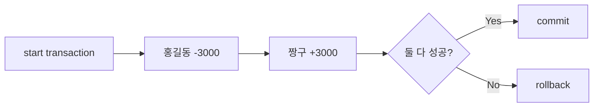

자바 컬렉션·예외·파일 입출력을 끝낸 다음 날, 곧바로 MySQL로 넘어가 SELECT부터 JOIN, 서브쿼리, DDL/DML, UNION, VIEW, INDEX, 트랜잭션까지 하루 만에 훑은 학습 노트다.

<!--more-->

## 자바 다음은 SQL (Situation)

지난주까지 자바로 "코드 안에서" 데이터를 다루는 법을 배웠다면, 오늘부터는 "데이터베이스 안에" 있는 데이터를 다루는 법을 배우기 시작했다. `wanted_lms`라는 연습용 DB(사용자·과정·수강·성적 테이블)를 띄워놓고, SELECT 기초부터 트랜잭션까지 하루 만에 쭉 훑었다.

## 배운 내용 (Task)

목표는 "어떤 열을 가져올 것인가"와 "어떤 행을 가져올 것인가"라는 SELECT의 두 축을 WHERE·정렬·집계·JOIN·서브쿼리로 확장하고, 테이블을 설계하는 DDL과 데이터를 조작하는 DML에서 제약조건이 실제로 막아주는 상황을 에러로 직접 겪어보고, 마지막으로 VIEW·INDEX·TRANSACTION까지 코드로 확인하는 것이었다.

## 정리한 내용 (Action)

### SELECT — 어떤 열을, WHERE — 어떤 행을

```sql
select
    menu_name as '메뉴 이름',
    menu_price as '가격'
from
    tbl_menu;
```

SQL의 핵심은 결국 두 가지였다. **어떤 열을 가져올지**(SELECT에 나열)와 **어떤 행을 가져올지**(WHERE 조건). `as`로 별칭을 붙이면 결과 컬럼명을 바꿔 보여줄 수 있다는 것부터 시작해서, WHERE의 비교 연산자(`=`, `!=`/`<>`, `BETWEEN`, `LIKE`, `IN`, `NOT`)를 하나씩 실습했다.

```sql
-- %단어 : 단어로 끝나는 데이터, 단어% : 단어로 시작, %단어% : 단어를 포함
where menu_name like '생마늘%';

where menu_price between 10000 and 20000;

where category_code not in (4, 5, 6);

-- NULL은 값이 아니라 "빈 공간"이라 = 로 비교할 수 없다
where ref_category_code is not null;
```

**`null = null`은 참이 아니다**는 점이 제일 헷갈렸다. NULL은 "값"이 아니라 "비어있음" 자체라서 `is null` / `is not null`로만 비교할 수 있었다.

### GROUP BY와 HAVING — 집계는 WHERE로 거를 수 없다

```sql
select
    status,
    count(*) as '사용자 수'
from
    users
group by
    status;
```

`count`, `sum`, `avg`, `max`, `min` 같은 집계 함수를 배우면서 바로 에러를 하나 마주쳤다.

```sql
-- 에러! name은 그룹 기준이 아닌데 count(*)와 같이 조회하려고 함
select name, count(*) as '총 사용자 수' from users;
```

**비집계 컬럼과 집계 함수를 같이 쓰면 에러가 난다** — `name`을 어떤 그룹으로 묶어야 할지 DB가 알 수 없기 때문이다. 그리고 `WHERE`와 `HAVING`의 차이도 코드로 확인했다: WHERE는 **그룹으로 묶기 전** 필터링, HAVING은 **그룹으로 묶은 후** 필터링.

```sql
-- where(완료 상태만) + having(묶은 후 2명 이상) 둘 다 필요한 케이스
select course_id, count(*) '학생 수'
from enrollments
where status = 'completed'
group by course_id
having count(*) >= 2;
```

### JOIN — 흩어진 테이블을 엮기

```sql
select c.title as '과정 제목', u.name as '교육자 이름'
from courses as c
join users as u on c.author_id = u.user_id;
```

`courses.author_id`가 `users.user_id`를 가리키는 외래키라는 걸 이용해 두 테이블을 엮었다. INNER와 LEFT/RIGHT의 차이는 **NULL이 있어도 출력하느냐**로 구분됐다.

```sql
-- 소셜 로그인을 안 한 사용자도 전부 보고 싶다면 LEFT JOIN
select u.name as '사용자 이름', uap.provider as '소셜 로그인 제공자'
from users as u left join user_auth_providers as uap
on u.user_id = uap.user_id;
```

### 서브쿼리 — 조건이 부족할 때 쿼리 안에 쿼리

"'홍길동'과 같은 년도에 가입한 사용자"처럼 조건이 한 번에 끝나지 않을 때, **쿼리 하나의 결과를 다른 쿼리의 조건으로 넣는** 서브쿼리를 썼다.

```sql
select name, created_at
from users
where year(created_at) = (
    select year(created_at) from users where name = '홍길동'
);
```

WHERE 절뿐 아니라 FROM 절에도 서브쿼리를 넣어, 집계 결과 자체를 "테이블처럼" 조인할 수 있다는 것도 확인했다.

### DDL — 제약조건은 "자동 경찰"

```sql
create table tb2(
    user_id int primary key,
    author_id int not null comment 'tb1 에서 전달 받는 외래키',
    email varchar(30) not null unique,
    foreign key(`author_id`) references `tb1`(`user_id`)
) comment '서비스 유저 정보 테이블2';
```

NOT NULL, UNIQUE, FOREIGN KEY 제약조건을 걸고 나서, 일부러 **tb1을 먼저 drop**해봤다. `tb2`가 `tb1.user_id`를 참조하고 있어서 부모 테이블을 먼저 지우려 하면 DB가 막아준다 — 제약조건이 "고아 데이터"를 막는 자동 경찰 역할을 한다는 걸 에러로 체감했다.

### DML — 에러 메시지가 곧 제약조건 설명서

```sql
-- UNIQUE 위반: 이미 있는 이메일
insert into users (`email`, `name`) values ('email2@gmail.com', '조평순');

-- FK 참조 무결성 위반: users에 없는 999번 저자
insert into courses (`author_id`, `title`, `description`)
values (999, 'SQL 제약조건!', '제약조건을 확인해보아요~');
```

일부러 제약조건을 어기는 INSERT를 여러 번 내보면서, **"에러가 나면 제약조건과 데이터 타입부터 의심하라"**는 패턴을 몸에 익혔다. 그리고 UPDATE·DELETE에서 가장 위험한 실수도 직접 봤다.

```sql
-- WHERE를 깜빡하면 users 테이블의 전체 행이 다 바뀐다!!
update users set `name` = '조평훈';
```

**WHERE 절을 빠뜨리면 테이블 전체가 대상이 된다**는 걸 코드로 직접 실행해보고 나니, "수정·삭제 전엔 반드시 PK/UNIQUE로 행을 하나로 좁혀라"는 말이 왜 그렇게 강조되는지 이해됐다.

### UNION — 합칠 땐 컬럼 개수와 타입이 맞아야 한다

```sql
-- 에러! 위는 2개 컬럼(email, status), 아래는 3개 컬럼(name, email, status)
select `email`, `status` from users where status = 'active';
union
select `name`, `email`, `status` from users where status = 'suspended';
```

UNION은 "중복을 제거하는 합집합"이라는 개념은 쉬웠는데, **합치는 두 쿼리의 컬럼 개수와 타입이 맞아야 한다**는 제약을 일부러 어겨서 에러로 확인했다.

### VIEW — 가상의 테이블로 권한을 나누기

```sql
create view v_courses_stats as
select c.course_id, c.title, count(e.enrollment_id) as '등록 학생 수'
from courses as c
left join enrollments as e on c.course_id = e.course_id
group by c.course_id, c.title;

select * from v_courses_stats where `등록 학생 수` >= 3;
```

데이터 분석팀에는 복잡한 집계 쿼리를, 마케팅팀에는 이메일·이름만 보이는 뷰를 제공한다는 시나리오로 VIEW를 배웠다. **"원본 테이블을 그대로 열어주지 않고 필요한 범위만 가상의 테이블로 잘라서 준다"**는 게 핵심이었다.

### INDEX — 목차를 만들어 전체 스캔을 없애기

```sql
explain select * from users where name = '홍길동';
-- 인덱스 적용 전: 120 row full scan

create index idx_users_name on users(name);

explain select * from users where name = '홍길동';
-- 인덱스 적용 후: 1 row만 scan
```

`explain`으로 실행 계획을 먼저 찍어보고, 인덱스를 건 다음 다시 찍어서 **120 row 전체 스캔이 1 row 스캔으로 줄어드는 걸 숫자로 확인**했다. 대신 인덱스는 공간을 더 쓰고 INSERT/UPDATE/DELETE를 느리게 만드는 트레이드오프가 있어서, "조회가 압도적으로 많고 거의 안 바뀌는 컬럼"에만 걸어야 한다는 것도 같이 배웠다.

### TRANSACTION — 계좌이체가 왜 하나의 단위여야 하는가



```sql
start transaction;
update accounts set balance = balance - 3000 where id = 1;
update accounts set balance = balance + 3000 where id = 99;  -- 없는 계좌!

rollback;  -- 둘 중 하나라도 실패하면 전부 되돌린다
```

계좌이체는 "차감 1번 + 증액 1번", 논리적으로는 하나의 작업이지만 실제로는 UPDATE가 두 번 일어난다. 일부러 두 번째 UPDATE의 대상 계좌를 존재하지 않는 `id=99`로 만들어서 `rollback`을 해보니, **여러 작업을 하나의 단위로 묶어야 하는 이유**가 바로 와닿았다.

## 결과 (Result)

SELECT의 두 축(열/행)에서 시작해 GROUP BY·JOIN·서브쿼리로 조회를 확장하고, DDL·DML에서는 제약조건을 일부러 어겨가며 에러 메시지로 원리를 체감했다. UNION·VIEW·INDEX·TRANSACTION까지 하루에 훑느라 빡빡했지만, 특히 WHERE 없는 UPDATE와 인덱스 전후 120→1 row 스캔은 숫자와 사고로 직접 겪어서 가장 오래 남을 것 같다.

## 더 학습하면 좋은 개념

- **정규화(Normalization)** — 오늘 다룬 테이블들은 이미 정규화되어 있었는데, 왜 users/courses/enrollments를 따로 나눴는지, 1NF~3NF가 무엇을 막아주는지 알아두면 DDL 설계를 스스로 할 때 도움이 된다.
- **복합 인덱스 / 커버링 인덱스** — 오늘은 컬럼 하나짜리 인덱스만 만들었는데, 여러 컬럼을 묶은 인덱스는 컬럼 순서에 따라 효과가 완전히 달라진다. 다음에 JOIN·GROUP BY가 많은 쿼리를 튜닝할 때 필요하다.
- **트랜잭션 격리 수준(Isolation Level)** — 오늘은 단일 세션에서 커밋/롤백만 봤는데, 여러 세션이 동시에 같은 계좌를 건드리면 무슨 일이 생기는지는 격리 수준을 배워야 이해된다.
- **ERD(개체-관계 다이어그램)** — courses, enrollments, user_auth_providers처럼 FK로 엮인 테이블이 늘어날수록 관계를 그림으로 먼저 그려보는 습관이 필요하다는 걸 느꼈다.

## 참고 자료

- [MySQL 공식 문서 - SELECT Statement](https://dev.mysql.com/doc/refman/8.0/en/select.html)
- [MySQL 공식 문서 - JOIN Clause](https://dev.mysql.com/doc/refman/8.0/en/join.html)
- [MySQL 공식 문서 - Optimization and Indexes](https://dev.mysql.com/doc/refman/8.0/en/mysql-indexes.html)
- [MySQL 공식 문서 - Transactional Statements](https://dev.mysql.com/doc/refman/8.0/en/sql-transactional-statements.html)
