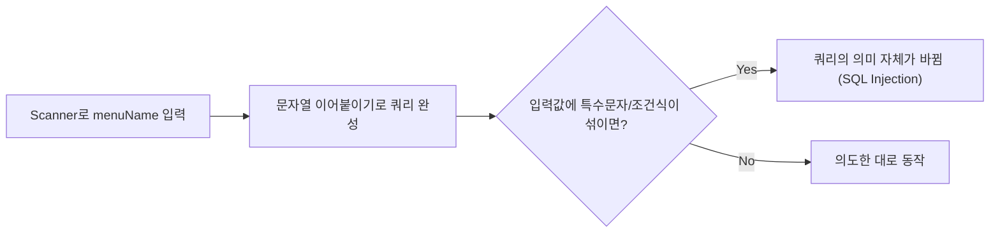

SQL을 터미널에서 직접 치던 걸 자바 코드 안으로 가져오는 날. Connection 연결, Statement의 SQL 인젝션 문제, PreparedStatement로의 교체, 그리고 Controller-Service-DAO 구조로 메뉴 CRUD를 완성한 학습 노트다.

<!--more-->

## SQL을 자바 코드 안으로 (Situation)

지난주에 SQL을 터미널(Workbench)에서 직접 실행해봤다면, 오늘은 그 쿼리를 **자바 코드가 대신 실행**하게 만드는 JDBC를 배웠다. `menudb`에 접속하는 것부터 시작해서, 하루 끝에는 Controller-Service-DAO로 나뉜 레이어드 구조로 메뉴 CRUD 콘솔 프로그램을 완성했다.

## 배운 내용 (Task)

목표는 `Connection`으로 DB에 접속하는 법, 접속 정보를 코드에서 분리하는 법, `Statement`의 SQL 인젝션 위험을 직접 겪고 `PreparedStatement`로 바꾸는 이유를 이해하는 것, 그리고 DAO-Service-Controller-View로 책임을 나눈 작은 CRUD 프로그램을 완성하는 것이었다.

## 정리한 내용 (Action)

### Connection — DB에 접속하는 첫 줄

```java
Class.forName("com.mysql.cj.jdbc.Driver");
con = DriverManager.getConnection(
        "jdbc:mysql://localhost/menudb", "wanted", "wanted"
);
```

`Connection`은 인터페이스라서 직접 `new`할 수 없고, 구현체를 제공하는 `DriverManager`를 통해서만 객체를 얻을 수 있었다. 처음 짠 코드는 `finally` 블럭에서 `con = null;`로 "정리"를 했는데, 이게 **자원 해제가 아니라 그냥 변수 참조를 끊는 것일 뿐**이라는 걸 나중에야 깨달았다. 실제로는 `con.close()`를 호출해야 커넥션이 반납된다.

### 접속 정보를 코드 밖으로 — Properties, 그리고 템플릿화

```java
Properties prop = new Properties();
prop.load(new FileReader("src/main/java/com/wanted/a_connection/jdbc-config.properties"));

String driver = prop.getProperty("driver");
String url = prop.getProperty("url");
```

지난번 자바 Map/Properties 글에서 "환경설정은 Key-Value 문자열로 다룬다"고 배운 걸, 오늘 **DB 접속 정보를 숨기는 용도**로 바로 써먹었다. 그리고 반복되는 연결/해제 코드를 `JDBCTemplate`이라는 유틸 클래스로 뽑아냈다.

```java
public static void close(Connection con) {
    try {
        if (con != null && !con.isClosed()) {
            con.close();
        }
    } catch (SQLException e) {
        throw new RuntimeException(e);
    }
}
```

**`con = null` 대신 `con.close()`를 호출하는 메서드로 통일**하면서, 처음에 뭘 놓쳤는지 확실히 체감했다.

### Statement의 함정 — SQL 인젝션

```java
rset = stmt.executeQuery(
    "SELECT MENU_CODE, MENU_PRICE, ORDERABLE_STATUS FROM TBL_MENU WHERE MENU_NAME = '" + menuName + "'"
);
```

메뉴 이름을 `Scanner`로 입력받아 **문자열을 그대로 이어붙여** 쿼리를 만들었다. 입력값에 작은따옴표(`'`)가 섞이거나 `' OR '1'='1`같은 값이 들어오면 쿼리 자체의 의미가 바뀔 수 있다는 걸 알고 나니, Statement로 사용자 입력을 직접 조립하는 게 왜 위험한지 바로 이해됐다.



### PreparedStatement — `?` 자리표시자로 값과 쿼리를 분리

```java
pstmt = con.prepareStatement("SELECT MENU_CODE, MENU_PRICE, ORDERABLE_STATUS FROM TBL_MENU WHERE MENU_NAME = ?");
pstmt.setString(1, menuName);
```

같은 기능을 `PreparedStatement`로 바꾸니, 사용자 입력은 `?` 자리에 **값으로만** 들어가고 쿼리 구조 자체에는 영향을 줄 수 없었다. 덤으로 "최초 1회만 파싱·컴파일하고 이후엔 재사용한다"는 성능상의 이유도 같이 배웠다. SELECT는 `executeQuery()`, INSERT/UPDATE/DELETE는 `executeUpdate()`를 쓰고 **영향받은 행의 개수(int)를 반환**한다는 것도 확인했다.

```java
result = pstmt.executeUpdate();
if (result > 0) {
    System.out.println(menuName + " 메뉴 가격 수정 성공!!");
} else {
    System.out.println(menuName + " 메뉴 가격 변경 실패!!");
}
```

### SQL을 XML로 분리하다가 겪은 오타

쿼리가 길어지니 `Properties.loadFromXML()`로 SQL을 별도 XML 파일에 빼두고 key로 불러오는 방식도 써봤다.

```java
prop.loadFromXML(new FileInputStream("src/main/java/com/wanted/b_prepatedstatements/menu-query.xml"));
```

그런데 실제 패키지명은 `b_preparedstatements`인데 경로 문자열에는 `b_prepatedstatements`라고 오타를 내서 `FileNotFoundException`을 만났다. **파일 경로를 문자열로 하드코딩하면 오타 하나로 바로 런타임 에러**라는 걸 직접 겪었다 — 다음 챕터의 레이어드 구조에서는 이 쿼리들을 클래스패스 리소스(`queries.xml`)로 한 번만 로드하는 방식으로 정리했다.

### 레이어드 구조로 CRUD 완성 — View·Controller·Service·DAO

```java
MenuService service = new MenuService();
MenuController controller = new MenuController(service);
MenuOutputView outputView = new MenuOutputView();
MenuInputView inputView = new MenuInputView(controller, outputView);

inputView.displayMainView();
```

각 계층의 역할을 명확히 나눴다: **View**는 Scanner 입력/출력만, **Controller**는 View와 Service 사이를 연결하는 "커맨드센터", **Service**는 비즈니스 로직, **DAO**는 실제 SQL 실행만 담당한다. Controller 주석에 적어둔 "Controller가 하면 안 되는 일"(Scanner 처리, 비즈니스 로직, SQL 작업)이 책임 분리 감각을 잡는 데 큰 도움이 됐다.

```java
public List<MenuDTO> findAll() throws SQLException {
    String query = QueryUtil.getQuery("menu.findAll");
    List<MenuDTO> menus = new ArrayList<>();

    try (PreparedStatement pstmt = connection.prepareStatement(query)) {
        ResultSet rset = pstmt.executeQuery();
        while (rset.next()) {
            menus.add(new MenuDTO(
                rset.getInt("MENU_CODE"), rset.getString("MENU_NAME"),
                rset.getInt("MENU_PRICE"), rset.getInt("CATEGORY_CODE"),
                rset.getString("ORDERABLE_STATUS")
            ));
        }
    }
    return menus;
}
```

지난 Java 학습 노트에서 "다음에 꼭 배워야 한다"고 적어뒀던 **try-with-resources**를 DAO에서 드디어 썼다 — `PreparedStatement`를 수동으로 닫지 않아도 블록이 끝나면 자동으로 닫힌다.

```java
// Application.java 주석
// 추후 배울 Spring 에서는 Application 이 실행되면
// 모든 객체가 조립이 된다. 지금은 그 구조를 미리 맛보기 형태로 작성해본다.
```

`Application`에서 Service·Controller·View 객체를 손으로 하나씩 `new`해서 엮는 걸 보면서, "이게 바로 나중에 Spring이 자동으로 해준다는 그 조립이구나"를 미리 맛본 느낌이었다.

## 결과 (Result)

Connection으로 DB에 접속하고 자원을 제대로 반납하는 법부터, Statement의 SQL 인젝션 위험을 직접 코드로 겪고 PreparedStatement로 바꾸는 이유를 이해했다. 경로 오타로 `FileNotFoundException`을 만난 것도 "하드코딩된 문자열 경로는 오타에 취약하다"는 교훈으로 남았다. 마지막으로 View-Controller-Service-DAO 레이어드 구조로 작은 CRUD 프로그램을 완성하면서, 각 계층이 뭘 책임지고 뭘 책임지면 안 되는지 감을 잡았다.

## 더 학습하면 좋은 개념

- **커넥션 풀(Connection Pool, HikariCP 등)** — 오늘은 요청마다 새 Connection을 만들고 닫았는데, 실제 서비스에서는 미리 만들어둔 커넥션을 재사용하는 풀을 쓴다. 왜 매번 새로 만드는 게 비효율적인지 다음에 알아봐야 한다.
- **배치 처리(Batch)** — 오늘 배운 `executeUpdate()`는 한 번에 한 건만 처리했는데, 여러 건을 한 번에 묶어 보내는 배치 처리를 알아두면 대량 데이터 작업에 도움이 된다.
- **ORM(Object-Relational Mapping)** — DAO에서 `ResultSet`을 한 줄씩 꺼내 DTO 필드에 수동으로 담는 코드를 오늘 계속 반복해서 짰는데, 이 매핑을 자동화해주는 게 ORM이라는 걸 다음 단계에서 배우게 될 것 같다.
- **XML/리소스 파일의 클래스패스 로딩** — 오늘 상대 경로 문자열로 접근하다 오타를 겪었는데, 레이어드 구조의 `QueryUtil`처럼 `getClassLoader().getResourceAsStream()`으로 클래스패스 기준으로 읽는 방식이 왜 더 안전한지 더 파보면 좋겠다.

## 참고 자료

- [Oracle 공식 문서 - JDBC Basics](https://docs.oracle.com/javase/tutorial/jdbc/basics/index.html)
- [Oracle 공식 문서 - Using Prepared Statements](https://docs.oracle.com/javase/tutorial/jdbc/basics/prepared.html)
- [OWASP - SQL Injection](https://owasp.org/www-community/attacks/SQL_Injection)
