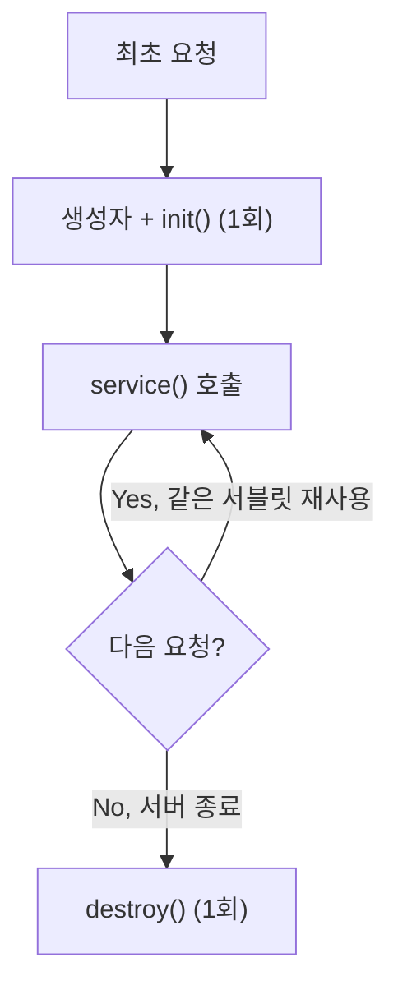

자바로 콘솔 프로그램만 만들다가 처음으로 "웹 요청"을 받아보는 날. 서블릿 생명주기, doGet/doPost 분리, 쿼리스트링·폼데이터로 파라미터 받는 법을 배운 학습 노트다.

<!--more-->

## 콘솔을 벗어나 웹으로 (Situation)

지금까지는 `Scanner`로 콘솔 입력을 받는 프로그램만 만들었는데, 오늘부터는 **브라우저의 요청을 받아 응답하는 서블릿**을 배우기 시작했다. `@WebServlet`으로 URL 하나에 클래스 하나를 매핑하는 것부터, GET과 POST를 분리해서 처리하는 법까지 다뤘다.

## 배운 내용 (Task)

목표는 서블릿의 생명주기(`init` → `service` → `destroy`)가 언제 몇 번 호출되는지 로그로 확인하고, `service()`를 직접 오버라이드하는 대신 `doGet`/`doPost`로 나누는 이유를 이해하고, 쿼리스트링과 폼데이터로 들어오는 파라미터를 꺼내 쓰는 법을 익히는 것이었다.

## 정리한 내용 (Action)

### 생명주기 — 서블릿은 요청마다 새로 안 만든다

```java
@WebServlet(value = "/life-cycle")
public class LifeCycleServlet extends HttpServlet {
    public LifeCycleServlet() { System.out.println("기본 생성자 호출됨..."); }

    @Override
    public void init(ServletConfig config) { System.out.println("init() 호출됨..." + initCount++); }

    @Override
    protected void service(HttpServletRequest req, HttpServletResponse resp) {
        System.out.println("service() 호출됨..." + serviceCount++);
    }

    @Override
    public void destroy() { System.out.println("destroy() 호출됨..." + destroyCount++); }
}
```

`/life-cycle`을 여러 번 새로고침해보니 **생성자와 `init()`은 딱 한 번만** 찍히고, `service()`는 요청할 때마다 카운트가 올라갔다. 자바 객체를 매번 `new`해서 쓰던 것과 달리, **서블릿 컨테이너가 인스턴스 하나를 계속 재사용한다**는 걸 로그로 직접 확인한 게 인상적이었다.



### service() 직접 오버라이드하기 vs doGet/doPost

```java
// 처음엔 이렇게 써봤다
// @Override
// protected void service(HttpServletRequest req, HttpServletResponse resp) {
//     String httpMethod = req.getMethod();
//     System.out.println("httpMethod = " + httpMethod);
// }

@Override
protected void doGet(HttpServletRequest req, HttpServletResponse resp) {
    System.out.println("GET 요청을 처리할 메소드 호출됨...");
}

@Override
protected void doPost(HttpServletRequest req, HttpServletResponse resp) {
    System.out.println("POST 요청을 처리할 메소드 호출됨...");
}
```

처음엔 `service()`를 직접 오버라이드해서 메서드 종류를 if문으로 분기하려 했는데, `HttpServlet`이 이미 `service()` 안에서 GET/POST에 따라 `doGet`/`doPost`로 나눠서 호출해주고 있었다. **직접 분기 코드를 짤 필요 없이, 처리하고 싶은 메서드만 오버라이드하면 되는 구조**라는 걸 알고 나니 왜 다들 `doGet`/`doPost`를 쓰는지 이해됐다.

### GET과 POST, 뭐가 다른가

| 구분 | GET | POST |
|------|-----|------|
| 데이터 위치 | URL (쿼리스트링) | Body(Payload) |
| 크기 제한 | 대략 200자 내외 | 훨씬 큼 |
| 보안 | URL에 노출됨 | 상대적으로 안 보임 |
| 용도 | 조회 | 등록/수정/삭제 |
| 속도 | 빠름 | 느림 |

"조회는 GET, 그 외 DML은 POST"라는 한 줄로 정리됐다.

### 파라미터 꺼내기 — 쿼리스트링과 폼데이터

```java
@WebServlet(value = "/querystring")
public class QueryStringServlet extends HttpServlet {
    @Override
    protected void doGet(HttpServletRequest req, HttpServletResponse resp) {
        // ?name=...&age=23&birthday=2004-04-29
        String name = req.getParameter("name");
        // URL로 오는 데이터는 전부 String! 원하는 타입으로 직접 파싱해야 한다
        int age = Integer.parseInt(req.getParameter("age"));
    }
}
```

**URL로 전달되는 값은 전부 문자열**이라서, 숫자로 쓰려면 `Integer.parseInt()` 같은 파싱이 항상 필요했다. 같은 `getParameter()`를 POST의 폼데이터에서도 그대로 쓸 수 있었다 — GET이냐 POST냐는 데이터가 어디(URL vs Body)에 실려오는지의 차이일 뿐, 꺼내는 코드는 동일하다는 게 재밌었다.

## 결과 (Result)

서블릿은 요청마다 새로 만들어지는 게 아니라 컨테이너가 재사용하는 싱글턴에 가까운 객체라는 걸 로그로 확인했고, `service()`를 직접 분기하는 대신 `doGet`/`doPost`로 나눠서 오버라이드하는 이유를 이해했다. GET/POST의 차이와 `getParameter()`로 파라미터를 꺼내는 법까지, 웹 요청을 받는 가장 기본적인 틀을 잡은 하루였다.

## 더 학습하면 좋은 개념

- **스레드 안전성(Thread-safety)** — 서블릿 인스턴스가 재사용된다는 건, 여러 요청이 동시에 같은 인스턴스의 `service()`를 동시에 실행할 수도 있다는 뜻이다. 그래서 서블릿에 인스턴스 변수를 함부로 두면 안 되는 이유를 더 파봐야 한다.
- **`HttpServletRequest`의 다른 메서드들** — 오늘은 `getParameter()`만 썼는데, 헤더를 읽는 `getHeader()`, 요청 방식을 알아내는 `getMethod()` 등도 있다는 걸 생명주기 예제에서 살짝 봤다.
- **멀티파트 폼(파일 업로드)** — 오늘 배운 폼데이터는 텍스트 위주였는데, 파일을 업로드하는 폼은 `enctype="multipart/form-data"`로 또 다르게 다룬다는 걸 다음에 배워야 한다.

## 참고 자료

- [Jakarta EE 공식 문서 - Servlet 명세](https://jakarta.ee/specifications/servlet/)
- [MDN - HTTP request methods](https://developer.mozilla.org/en-US/docs/Web/HTTP/Methods)
