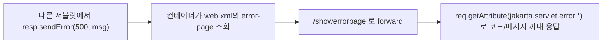

404/500 에러를 전용 서블릿으로 보여주는 법, 그리고 요청을 다른 서블릿에 넘기는 두 가지 방식 — forward와 redirect의 차이를 직접 눈으로 비교한 학습 노트다.

<!--more-->

## 응답을 직접 만든 다음, 넘기는 법을 배우다 (Situation)

어제 GET/POST로 요청을 받는 법을 배웠다면, 오늘은 **응답을 PrintWriter로 직접 조립하는 법**부터 시작해서, 에러가 났을 때 보여줄 전용 페이지, 그리고 한 서블릿의 일을 다른 서블릿에게 넘기는 forward·redirect까지 배웠다.

## 배운 내용 (Task)

목표는 `HttpServletResponse`로 HTML 응답을 직접 만들어보고, `web.xml`의 `<error-page>`로 404·500 에러를 전용 서블릿에 연결하는 법, 그리고 forward와 redirect가 겉보기엔 비슷해 보여도 URL·데이터 공유·새로고침 시 동작이 어떻게 다른지 구분하는 것이었다.

## 정리한 내용 (Action)

### Response 직접 조립하기

```java
StringBuilder response = new StringBuilder();
response.append("<!doctype html>\n")
        .append("<html>\n<body>\n")
        .append("<h1>Servlet 의 응답 결과!</h1>")
        .append("</body>\n</html>\n");

resp.setContentType("text/html; charset=UTF-8");
PrintWriter out = resp.getWriter();
out.print(response);
out.flush();
out.close();
```

**`resp.setContentType("text/html; charset=UTF-8")`을 빼먹으면 한글이 깨진다**는 걸 여러 서블릿에서 반복해서 겪고 나니, 이게 왜 거의 모든 예제에 들어가는 고정 코드인지 체감했다.

### 404/500 에러 페이지 — web.xml로 연결하기

```xml
<error-page>
    <error-code>404</error-code>
    <location>/showerrorpage</location>
</error-page>
<error-page>
    <error-code>500</error-code>
    <location>/showerrorpage</location>
</error-page>
```

```java
@WebServlet("/show500")
public class Show500Servlet extends HttpServlet {
    protected void doGet(HttpServletRequest req, HttpServletResponse resp) {
        // throw new Exception(); 에러가 터진다는 가정
        resp.sendError(500, "500번대 Error 는 순전히 개발자의 잘못.");
    }
}
```

`resp.sendError(500, ...)`를 호출하면 컨테이너가 `web.xml`에 등록된 `/showerrorpage`로 **에러 정보를 가지고 다시 요청을 보내준다**는 걸 확인했다. 그 안에서는 `req.getAttribute("jakarta.servlet.error.status_code")`, `"jakarta.servlet.error.message"` 같은 **컨테이너가 미리 채워주는 속성값**으로 에러 코드와 메시지를 꺼내 화면을 만들었다.



### forward — 요청을 그대로 넘기면서 책임을 분리하기

```java
// RequestInfoServlet: 로그인 처리만 담당
req.setAttribute("userId", id);
RequestDispatcher rd = req.getRequestDispatcher("/print");
rd.forward(req, resp);
```

```java
// ResponseLoginServlet: 응답 조립만 담당
String id = req.getAttribute("userId").toString();
// "~~님 환영합니다" HTML 응답
```

로그인 처리를 하는 서블릿과 응답 HTML을 만드는 서블릿을 **분리**해서, `req.setAttribute()`로 값을 실어 `forward()`로 넘겼다. forward의 특징을 코드 주석으로 정리하며 익혔다:

- forward하는 서블릿과 forward받는 서블릿이 **같은 `req`, `resp` 객체를 공유**한다.
- forward받는 서블릿의 존재는 클라이언트에게 **노출되지 않는다** — URL이 바뀌지 않는다.
- 그래서 forward 응답 화면에서 **새로고침하면 같은 요청이 반복**된다. 조회(SELECT)는 괜찮지만, **INSERT/UPDATE/DELETE를 forward로 구현하면 중복 실행이 날 수 있다.**

### redirect — URL 자체를 바꿔서 이전 요청을 끊어내기

```java
@WebServlet("/redirect")
public class RedirectServlet extends HttpServlet {
    protected void doGet(HttpServletRequest req, HttpServletResponse resp) {
        // resp.sendRedirect("재요청경로")
        // ...
    }
}
```

`sendRedirect()`는 브라우저에게 "다른 URL로 다시 요청해"라고 지시하는 방식이라, **URL 주소창이 실제로 바뀐다** — 사용자가 직접 `<a>` 태그를 누른 것과 같은 효과라서 무조건 GET 방식이 된다. 그 결과 forward와 정반대로, **새로고침해도 이전 요청 정보가 남아있지 않아 DML 중복 실행 걱정이 없다.** 대신 "이전 요청을 아예 모른다"는 게 redirect의 장점이자 단점이었다.

| 구분 | forward | redirect |
|------|---------|----------|
| URL 변화 | 없음 | 있음 |
| req/resp 공유 | 공유함 | 공유 안 함(새 요청) |
| 새로고침 시 | 이전 요청 반복 위험(DML 주의) | 안전 |
| 적합한 상황 | 조회 결과를 다른 서블릿이 보여줄 때 | 로그인 처리 후 메인으로 이동 등 |

마지막 주석에서 **"redirect의 '이전 요청을 모른다'는 단점을 극복하려고 나온 게 Cookie/Session"**이라고 미리 적혀 있어서, 다음 수업이 뭘 다룰지 자연스럽게 예고됐다.

## 결과 (Result)

Response를 직접 조립할 때 Content-Type을 빼먹으면 한글이 깨진다는 걸 반복해서 겪었고, 404/500 에러가 `web.xml`의 `error-page` 설정을 통해 전용 서블릿으로 다시 요청된다는 흐름을 확인했다. 가장 크게 남은 건 forward와 redirect의 차이 — **"요청을 공유하며 몰래 넘기는 것"과 "아예 새 요청을 시키는 것"**이라는 구분이, 왜 DML은 forward로 짜면 안 되는지까지 이어져서 이해가 됐다.

## 더 학습하면 좋은 개념

- **PRG 패턴(Post-Redirect-Get)** — 오늘 배운 "DML은 redirect로"라는 규칙이 실무에서는 POST 처리 후 GET으로 redirect하는 PRG 패턴으로 정형화되어 있다는 걸 다음에 찾아보면 좋겠다.
- **`RequestDispatcher.include()`** — forward 말고 include라는 메서드도 있다는 걸 API에서 봤는데, forward와 뭐가 다른지는 아직 안 다뤘다.
- **커스텀 에러 응답 포맷(JSON)** — 오늘은 HTML로 에러 페이지를 만들었는데, API 서버라면 JSON으로 에러를 응답해야 할 텐데 그건 어떻게 다르게 설계하는지 궁금해졌다.

## 참고 자료

- [Jakarta Servlet 공식 문서 - RequestDispatcher](https://jakarta.ee/specifications/servlet/6.0/apidocs/jakarta.servlet/jakarta/servlet/requestdispatcher)
- [MDN - 300번대 리다이렉션 메시지](https://developer.mozilla.org/ko/docs/Web/HTTP/Status#%EB%A6%AC%EB%8B%A4%EC%9D%B4%EB%A0%89%EC%85%98_%EB%A9%94%EC%8B%9C%EC%A7%80)
