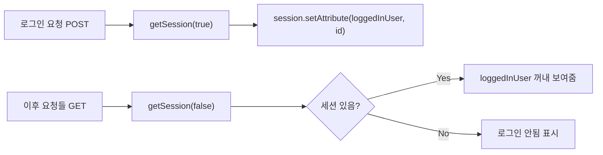

redirect는 이전 요청을 기억 못 한다는 문제를, 쿠키와 세션으로 해결하는 법. 그리고 서블릿에 도달하기 전에 공통 로직을 끼워넣는 필터 체인까지 정리한 학습 노트다.

<!--more-->

## redirect의 단점을 메꾸는 두 가지 (Situation)

지난 시간 redirect 예제 끝에 "이전 요청을 아예 모른다는 게 redirect의 단점이고, 이걸 극복하려고 Cookie/Session이 나왔다"고 적어뒀는데, 오늘 그 예고가 그대로 이어졌다. 쿠키·세션으로 로그인 상태를 유지하는 법과, 서블릿 앞단에서 공통 로직을 처리하는 Filter까지 배웠다.

## 배운 내용 (Task)

목표는 `Cookie` 객체로 브라우저에 값을 저장·조회하는 법, `HttpSession`으로 서버 쪽에 로그인 상태를 저장하고 유효시간을 관리하는 법, 그리고 `Filter`로 인증·인코딩·성능 측정 같은 공통 관심사를 서블릿 앞단에서 처리하는 법을 익히는 것이었다.

## 정리한 내용 (Action)

### Cookie — 브라우저에 값을 맡겨두기

```java
Cookie cookie = new Cookie("userValue", cookieValue);
cookie.setMaxAge(60 * 60); // 1시간
resp.addCookie(cookie);
```

```java
Cookie[] cookies = req.getCookies();
if (cookies != null) {
    for (Cookie cookie : cookies) {
        if ("userValue".equals(cookie.getName())) {
            savedValue = cookie.getValue();
            break;
        }
    }
}
```

쿠키는 **서버가 아닌 브라우저에 값을 저장**해두고, 이후 요청마다 브라우저가 자동으로 실어 보내주는 방식이었다. `req.getCookies()`가 배열을 반환하기 때문에, 원하는 쿠키 하나를 찾으려면 **이름으로 직접 순회해서 비교**해야 했다 — `req.getParameter()`처럼 이름으로 바로 꺼낼 수 없다는 게 처음엔 어색했다.

### Session — 서버가 기억하는 로그인 상태

```java
// 로그인 시 (doPost)
HttpSession session = req.getSession(true); // 없으면 새로 생성
session.setAttribute("loggedInUser", userId);
session.setMaxInactiveInterval(30); // 유효 시간 30초(테스트용)

// 로그인 확인 시 (doGet)
HttpSession session = req.getSession(false); // 없으면 null
if (session != null) {
    loggedInUser = (String) session.getAttribute("loggedInUser");
}
```

**`getSession(true)`와 `getSession(false)`의 차이**가 핵심이었다. `true`는 세션이 없으면 새로 만들고, `false`는 없으면 그냥 `null`을 반환한다. 로그인 화면에서는 세션이 없으면 만들어야 하니 `true`를, 로그인 여부를 "확인만" 하는 곳에서는 함부로 세션을 만들지 않도록 `false`를 쓰는 식으로 구분해서 썼다.



세션에서 값을 꺼낼 때도 `.toString()`으로 바로 호출하면 값이 없을 때 `NullPointerException`이 날 수 있어서, `(String)` 캐스트 연산자로 바꾸는 게 더 안전하다는 걸 코드를 고쳐보며 확인했다.

### Filter — 서블릿에 도달하기 전에 가로채기

```java
@WebFilter("/*")
public class PerformanceFilter implements Filter {
    public void doFilter(ServletRequest request, ServletResponse response, FilterChain chain) {
        long startTime = System.currentTimeMillis();
        HttpServletRequest req = (HttpServletRequest) request;
        System.out.println("[요청 된 URL] : " + req.getRequestURI());

        chain.doFilter(request, response);  // 다음 필터 또는 서블릿 호출

        long endTime = System.currentTimeMillis();
        System.out.println("[" + req.getRequestURI() + " 의 최종 수행 시간] : " + (endTime - startTime) + "(ms)");
    }
}
```

필터는 **요청이 서블릿에 도달하기 전에** 끼어들 수 있는 생명주기를 갖고 있었다. `chain.doFilter()`를 **호출하기 전/후로 코드를 감싸는 것**만으로 모든 요청의 처리 시간을 잴 수 있다는 게 신기했다 — 서블릿 코드를 하나도 건드리지 않고 관심사를 분리한 셈이다.

```java
@WebFilter("/auth/*")
public class LoginFilter implements Filter {
    public void doFilter(ServletRequest request, ServletResponse response, FilterChain chain) {
        HttpServletRequest req = (HttpServletRequest) request;
        HttpSession session = req.getSession(false);

        if (session == null || session.getAttribute("loggedInUser") == null) {
            ((HttpServletResponse) response).sendRedirect("/h_cookie_session/cookie_session.html");
        } else {
            chain.doFilter(req, resp); // 로그인 되어 있으면 통과
        }
    }
}
```

`/auth/*` 경로로 들어오는 요청만 가로채서, **세션에 로그인 정보가 없으면 서블릿까지 가지도 못하고 로그인 페이지로 돌려보낸다.** 로그인 체크를 서블릿마다 반복해서 넣는 대신 필터 하나로 모아둔다는 게 핵심이었다.

인코딩을 설정하는 `EncodingFilter`는 `@WebFilter` 대신 `web.xml`에 등록하고 `filterConfig.getInitParameter("encoding-type")`로 초기화 파라미터를 받는 방식도 같이 봤다 — 어노테이션과 XML, 두 가지 등록 방법이 있다는 것까지만 비교해보고, 실제 `web.xml` 설정까지는 다음에 마저 연결해보기로 했다.

## 결과 (Result)

쿠키는 브라우저가, 세션은 서버가 로그인 상태를 기억한다는 역할 차이를 코드로 구분했고, `getSession(true/false)`를 상황에 맞게 골라 쓰는 감각을 잡았다. 무엇보다 Filter로 인증·성능 측정 같은 공통 로직을 `chain.doFilter()` 앞뒤에 끼워 넣는 구조를 보면서, 서블릿 하나하나에 반복 코드를 넣지 않아도 되는 이유를 체감했다. 다음 Spring Core로 넘어가면 이 "공통 관심사를 분리하는" 감각이 AOP로 이어질 것 같다.

## 더 학습하면 좋은 개념

- **쿠키 보안 옵션(`HttpOnly`, `Secure`, `SameSite`)** — 오늘은 `setMaxAge()`만 써봤는데, 자바스크립트 접근을 막거나 HTTPS에서만 전송되게 하는 옵션들도 실무에서는 필수라고 들었다.
- **필터 체인의 순서** — `web.xml`이나 `@Order`로 여러 필터의 실행 순서를 어떻게 정하는지는 오늘 다루지 않았다. PerformanceFilter와 LoginFilter가 같이 걸리면 어떤 순서로 도는지 궁금해졌다.
- **세션 고정 공격(Session Fixation)** — 로그인 성공 시 세션 ID를 그대로 쓰는지, 새로 발급하는지에 따라 보안 이슈가 생길 수 있다는 걸 들었는데 오늘 예제는 거기까지 다루지 않았다.

## 참고 자료

- [Jakarta Servlet 공식 문서 - HttpSession](https://jakarta.ee/specifications/servlet/6.0/apidocs/jakarta.servlet/jakarta/servlet/http/httpsession)
- [Jakarta Servlet 공식 문서 - Filter](https://jakarta.ee/specifications/servlet/6.0/apidocs/jakarta.servlet/jakarta/servlet/filter)
- [OWASP - Session Management Cheat Sheet](https://cheatsheetseries.owasp.org/cheatsheets/Session_Management_Cheat_Sheet.html)
