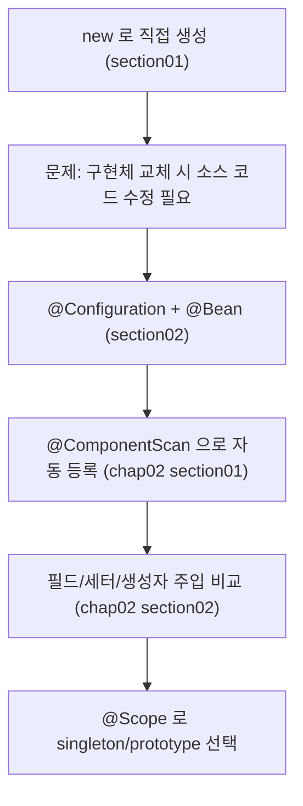

JDBC 레이어드 아키텍처 글 끝에 "Spring은 이 조립을 자동으로 해준다"고 적어뒀던 그 Spring을 드디어 시작했다. 객체를 직접 `new`하던 습관을 버리고, IoC 컨테이너와 세 가지 의존성 주입 방식을 배운 학습 노트다.

<!--more-->

## 드디어 예고했던 Spring (Situation)

JDBC로 메뉴 CRUD를 만들 때 `Application`에서 Service·Controller·View를 손으로 하나씩 `new`해서 엮었는데, 그 코드 주석에 "Spring은 이걸 자동으로 해준다"고 적혀 있었다. 오늘 그 자동 조립을 담당하는 **IoC 컨테이너**와, 컨테이너가 객체를 연결해주는 **의존성 주입(DI)**을 배웠다.

## 배운 내용 (Task)

목표는 개발자가 직접 `new`로 객체를 만들 때 생기는 문제를 체감하고, `@Configuration`/`@Bean`으로 직접 등록하는 방식과 `@ComponentScan`으로 자동 스캔하는 방식을 비교하고, 필드·세터·생성자 세 가지 주입 방식의 장단점을 이해하고, Bean의 싱글톤/프로토타입 스코프 차이를 코드로 확인하는 것이었다.

## 정리한 내용 (Action)

### 문제 상황 — new로 직접 연결하면 생기는 일

```java
public class PaymentService {
    private KakaoPayGateway kakaoPayGateway;

    public PaymentService() {
        this.kakaoPayGateway = new KakaoPayGateway();  // 직접 생성
    }

    public boolean processPay(String orderID, int amount) {
        boolean result = kakaoPayGateway.pay(orderID, amount);
        // ...
    }
}
```

`PaymentService`가 `KakaoPayGateway`를 `new`로 직접 만들어 쓰고 있어서, **네이버페이로 바꾸려면 `PaymentService`의 소스 코드 자체를 고쳐야** 했다. 비즈니스 로직과 "어떤 구현체를 쓸지"가 완전히 엉켜있다는 걸 코드로 직접 겪었다.

### @Configuration·@Bean — IoC 컨테이너에 등록하고 꺼내 쓰기

```java
@Configuration
public class AppConfig {
    @Bean
    public KakaoPayGateway kakaoPayGateway() { return new KakaoPayGateway(); }

    @Bean
    public PaymentService paymentService() {
        return new PaymentService(kakaoPayGateway());  // 인터페이스로 주입!
    }
}
```

```java
ApplicationContext context = new AnnotationConfigApplicationContext(AppConfig.class);
PaymentService paymentService = context.getBean("paymentService", PaymentService.class);
```

**IoC 컨테이너(= ApplicationContext = BeanFactory)가 객체 생성과 연결을 대신 맡아준다.** 이제 `PaymentService`는 `PaymentInterface`라는 **타입**만 알면 되고, 실제로 카카오페이를 쓸지 네이버페이를 쓸지는 `AppConfig`에서만 결정한다. 구현체를 바꿔도 `PaymentService` 코드는 건드릴 필요가 없어졌다.

### @ComponentScan — 일일이 @Bean 안 적어도 되게

```java
@Configuration
@ComponentScan(basePackages = "com.wanted.di.section01",
    excludeFilters = @ComponentScan.Filter(
        // type = FilterType.ASSIGNABLE_TYPE, classes = {PaymentService.class}
        // type = FilterType.ANNOTATION, classes = {Service.class}
        // type = FilterType.REGEX, pattern = {"com.wanted.di.section01.service.*"}
    )
)
public class AppConfig { }
```

`@Bean` 메서드를 하나하나 작성하는 대신, **지정한 패키지를 스캔해서 `@Component`(또는 그 특수형인 `@Service`, `@Repository` 등)가 붙은 클래스를 자동으로 Bean 등록**해주는 방식도 배웠다. `excludeFilters`로 클래스명/어노테이션/정규표현식 세 가지 방법으로 스캔 대상을 제외할 수 있다는 것도 확인했다 — basePackages를 안 주면 `@ComponentScan`이 붙은 클래스와 **같은 패키지까지만** 스캔한다는 범위 제한도 중요했다.

### 의존성 주입 3형제 — 필드, 세터, 생성자

```java
// 1. 필드 주입
@Autowired
private PaymentInterface paymentInterface;
// 단점: final 불가, 필드에 직접 new로 대입해도 컴파일 에러 안 남

// 2. 세터 주입
@Autowired
public void setPaymentInterface(PaymentInterface paymentInterface) {
    this.paymentInterface = paymentInterface;
}
// 단점: final 불가, setter 호출 전까지 null / 장점: 선택적 의존관계 가능

// 3. 생성자 주입 (Spring 공식 권장)
private final PaymentInterface paymentInterface;

@Autowired
public PaymentServiceConstructor(PaymentInterface paymentInterface) {
    this.paymentInterface = paymentInterface;
}
// 장점: final로 불변성 보장, 필수 의존성을 객체 생성 시점에 강제
```

세 방식을 나란히 써보고 나서야 **왜 생성자 주입이 공식 권장인지** 체감됐다. 필드·세터 주입은 `final`을 못 써서 중간에 다른 구현체로 바꿔치기당해도 컴파일러가 못 막아주는데, 생성자 주입은 `final` 덕분에 **한 번 조립되면 끝까지 바뀌지 않는다**는 걸 보장한다.

### Bean Scope — 싱글톤 vs 프로토타입

```java
@Bean("single")
@Scope("singleton")  // 기본값. 컨테이너에 단 1개의 인스턴스
public PaymentService paymentService() { return new PaymentService(kakaoPayGateway()); }

@Bean("proto")
@Scope("prototype")  // getBean() 할 때마다 매번 새 인스턴스
public PaymentService paymentService2() { return new PaymentService(kakaoPayGateway()); }
```

```java
PaymentService single = context.getBean("single", PaymentService.class);
single.processPay("order-001", 3);
PaymentService single2 = context.getBean("single", PaymentService.class);
// single2 의 orderId 도 "order-001" — 같은 인스턴스를 공유하기 때문!

PaymentService proto2 = context.getBean("proto", PaymentService.class);
// proto2 는 processPay를 호출한 적 없는 "새 인스턴스"라 orderId가 다르다
```

같은 이름으로 `getBean()`을 두 번 호출했을 때 **싱글톤은 상태가 공유**되고, **프로토타입은 매번 새 인스턴스**라는 걸 `orderId` 값으로 직접 확인했다. Bean은 기본이 싱글톤이라 메모리 효율적이고 동작을 예측하기 쉽지만, 상태를 갖는 객체를 싱글톤으로 잘못 쓰면 여러 요청이 상태를 공유해버리는 문제가 생길 수 있다는 것도 함께 와닿았다.



## 결과 (Result)

`new`로 객체를 직접 만들 때의 결합도 문제를 직접 겪고 나서, IoC 컨테이너가 그 조립을 대신 맡아준다는 게 왜 필요한지 체감했다. `@Bean` 수동 등록과 `@ComponentScan` 자동 등록을 비교하고, 세 가지 DI 방식 중 생성자 주입이 권장되는 이유(불변성·필수 의존성 강제)를 이해했다. Bean 스코프까지 더하니, JDBC에서 손으로 하던 객체 조립이 왜 Spring에서는 어노테이션 몇 개로 끝나는지 그림이 그려졌다.

## 더 학습하면 좋은 개념

- **@Qualifier / @Primary** — 오늘은 인터페이스 구현체가 하나뿐이라 문제가 없었는데, 같은 타입의 Bean이 여러 개면 `@Autowired`가 어떤 걸 골라야 할지 모호해진다. 이걸 해결하는 어노테이션들을 다음에 써봐야 한다.
- **Bean 생명주기 콜백(`@PostConstruct`, `@PreDestroy`)** — 서블릿의 `init()`/`destroy()`처럼 Bean에도 초기화·소멸 시점에 끼어드는 방법이 있다고 들었는데 오늘은 다루지 않았다.
- **request/session 스코프** — 오늘 배운 건 singleton/prototype뿐인데, 웹 환경에서는 요청 단위·세션 단위로 Bean을 만드는 스코프도 있다고 하니 서블릿에서 배운 세션 개념과 연결해서 봐야겠다.

## 참고 자료

- [Spring 공식 문서 - IoC Container](https://docs.spring.io/spring-framework/reference/core/beans/introduction.html)
- [Spring 공식 문서 - Dependency Injection](https://docs.spring.io/spring-framework/reference/core/beans/dependencies/factory-collaborators.html)
- [Spring 공식 문서 - Bean Scopes](https://docs.spring.io/spring-framework/reference/core/beans/factory-scopes.html)
