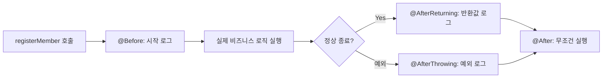

회원가입·조회·탈퇴 메소드마다 똑같이 반복되던 로깅·성능측정 코드를 전부 들어내고, `@Aspect`로 한 곳에 모으는 AOP를 배운 학습 노트다.

<!--more-->

## 모든 메소드에 복사-붙여넣기 된 코드 (Situation)

어제 IoC·DI로 "객체를 어떻게 연결할지"를 배웠다면, 오늘은 "여러 메소드에 걸쳐 반복되는 코드를 어떻게 한 곳으로 모을지"를 배웠다. 회원가입·조회·비밀번호변경·탈퇴, 네 개의 메소드 전부에 성능 측정과 로깅, 트랜잭션 코드가 똑같이 반복되어 있는 `MemberService`를 보는 것부터 시작했다.

## 배운 내용 (Task)

목표는 "횡단 관심사(cross-cutting concern)"가 왜 문제인지 체감하고, `@Aspect`·`@Pointcut`·다섯 가지 Advice(`@Before`, `@After`, `@AfterReturning`, `@AfterThrowing`, `@Around`)로 그 반복 코드를 분리하는 법, 그리고 여러 Aspect가 겹칠 때 순서를 정하는 법을 익히는 것이었다.

## 정리한 내용 (Action)

### 횡단 관심사 — 모든 메소드에 똑같이 박혀있는 코드

```java
public void registerMember(MemberDTO member) {
    long startTime = System.currentTimeMillis();          // 성능 측정 #1
    try {
        System.out.println("[로그] 회원 가입 시작: " + member.getEmail());  // 로깅 #2
        // beginTransaction();                              // 트랜잭션 #3
        // ----- 핵심 비즈니스 로직 -----
        // ...
        // commitTransaction();
        System.out.println("[로그] 회원 가입 성공: " + member.getEmail());
    } catch (Exception e) {
        // rollbackTransaction();
        System.out.println("[로그] 회원 가입 실패: " + e.getMessage());
        throw e;
    } finally {
        long endTime = System.currentTimeMillis();
        System.out.println("[성능] 회원 가입 처리 시간: " + (endTime - startTime) + "ms");
    }
}
```

`registerMember`, `getMember`, `updatePassword`, `deleteMember` **네 메소드 전부 이 패턴을 그대로 복붙**하고 있었다. 핵심 비즈니스 로직(유효성 검증, 저장/조회/삭제)은 몇 줄 안 되는데, 성능측정·로깅·트랜잭션 코드가 메소드마다 중복되어 있으니 **"이 메소드가 실제로 뭘 하는지"를 코드만 보고 알기 어려웠다.**

### @Aspect로 관심사를 한 곳에 모으기

```java
@Service
public class MemberService {
    public void registerMember(MemberDTO member) {
        // ----- 핵심 비즈니스 로직만 남음 -----
        if (member.getEmail() == null || member.getEmail().isEmpty()) {
            throw new IllegalArgumentException("이메일은 필수입니다.");
        }
        // ...
        memberRepository.put(member.getEmail(), member);
    }
}
```

비즈니스 로직만 남기고 로깅·성능측정 코드를 전부 들어낸 다음, `@Aspect` 클래스로 옮겼다.

```java
@Component
@Aspect
public class LoggingAspect {

    @Before("execution(* com.wanted.aop.section02.MemberService.*(..))")
    public void logBefore(JoinPoint joinPoint) {
        String methodName = joinPoint.getSignature().getName();
        System.out.println("[Before 로그] " + methodName + " 메소드 실행 시작됨");
    }

    @After("execution(* com.wanted.aop.section02.MemberService.*(..))")
    public void logAfter(JoinPoint joinPoint) { /* ... */ }

    @AfterReturning(pointcut = "execution(* com.wanted.aop.section02.MemberService.*(..))", returning = "result")
    public void logAfterReturning(JoinPoint joinPoint, Object result) { /* ... */ }

    @AfterThrowing(pointcut = "execution(* com.wanted.aop.section02.MemberService.*(..))", throwing = "exception")
    public void logAfterThrowing(JoinPoint joinPoint, Exception exception) { /* ... */ }
}
```

`execution(* com.wanted.aop.section02.MemberService.*(..))`라는 **Pointcut 표현식 하나**가 "`MemberService`의 모든 메소드"를 가리키고, 그 지점에 `@Before`(실행 전), `@After`(실행 후, 성공/실패 상관없이), `@AfterReturning`(정상 반환 후, 반환값도 받을 수 있음), `@AfterThrowing`(예외 발생 시)이 각각 끼어든다. **메소드 하나를 고치지 않고도, Aspect 클래스에만 손대면 네 메소드 전부에 동시 적용**된다는 게 핵심이었다.



### @Around — 메소드 앞뒤를 직접 감싸는 가장 강력한 Advice

```java
@Component
@Aspect
@Order(1)
public class PerformanceAspect {

    @Around("execution(* com.wanted.aop.section02.MemberService.*(..))")
    public Object performance(ProceedingJoinPoint joinPoint) {
        long startTime = System.currentTimeMillis();
        try {
            return joinPoint.proceed();  // 타겟 메소드를 직접 호출
        } catch (Throwable e) {
            throw new RuntimeException(e);
        } finally {
            long endTime = System.currentTimeMillis();
            System.out.println("[Around 성능 측정] " + joinPoint.getSignature().getName()
                    + " 메소드 실행 시간: " + (endTime - startTime) + "(ms)");
        }
    }
}
```

다른 Advice들과 달리 `@Around`는 **`ProceedingJoinPoint.proceed()`를 직접 호출해야 타겟 메소드가 실행된다.** 서블릿 Filter에서 `chain.doFilter()` 앞뒤로 코드를 감쌌던 것과 똑같은 구조라는 게 바로 연결됐다 — `proceed()` 앞은 시작 시간 측정, 뒤는 종료 시간 측정이라서 **성능 측정에는 `@Around`가 가장 자연스러웠다.**

### 여러 Aspect가 겹칠 때 — @Order

지난 Servlet 글에서 "Filter가 여러 개 걸리면 어떤 순서로 도는지 궁금해졌다"고 적어뒀는데, 오늘 AOP에서 그 답의 일부를 봤다. `PerformanceAspect`에 붙은 `@Order(1)`이 **여러 Aspect가 같은 지점에 동시에 적용될 때 실행 순서를 숫자로 정해준다** — 숫자가 작을수록 먼저 적용된다.

## 결과 (Result)

성능측정·로깅·트랜잭션 코드가 메소드마다 복붙되어 있던 `MemberService`를, `@Aspect`와 Pointcut 표현식으로 한 곳에 모아 핵심 로직만 남겼다. `@Before`/`@After`/`@AfterReturning`/`@AfterThrowing`으로 시점별 처리를, `@Around`로는 Filter의 `chain.doFilter()`와 똑같은 "앞뒤로 감싸기" 패턴을 구현한다는 걸 이해했다. 여러 Aspect의 실행 순서를 `@Order`로 정한다는 것도 확인해서, 지난 Filter 글에서 남겨둔 궁금증 하나를 풀었다.

## 더 학습하면 좋은 개념

- **Pointcut 재사용(`@Pointcut`)** — 오늘은 같은 `execution(...)` 문자열을 Aspect마다 반복해서 적었는데, `@Pointcut`으로 이름을 붙여 재사용하는 법을 알아보면 중복을 더 줄일 수 있을 것 같다.
- **트랜잭션 AOP(`@Transactional`)** — 오늘 주석에 의사코드로만 적어둔 `beginTransaction()`/`commitTransaction()`이, 실제로는 Spring이 AOP로 구현한 `@Transactional` 어노테이션 하나로 끝난다고 들었다. 다음에 DB와 연결할 때 꼭 써봐야 한다.
- **AOP의 내부 동작 원리(프록시)** — Aspect가 실제로 어떻게 메소드 호출에 끼어드는지(JDK 동적 프록시 vs CGLIB) 오늘은 다루지 않았는데, "진짜 객체가 아니라 프록시가 대신 호출을 가로챈다"는 원리를 알아야 AOP가 왜 특정 상황(같은 클래스 내부 호출 등)에서 안 먹히는지도 이해될 것 같다.

## 참고 자료

- [Spring 공식 문서 - Aspect Oriented Programming with Spring](https://docs.spring.io/spring-framework/reference/core/aop.html)
- [Spring 공식 문서 - Declaring Advice](https://docs.spring.io/spring-framework/reference/core/aop/ataspectj/advice.html)
