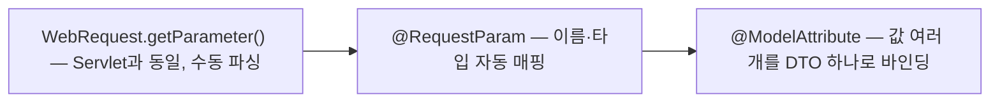

Servlet을 직접 만들던 걸 멈추고, Spring MVC의 @Controller로 넘어온 날. URL 매핑 방식과, 요청 파라미터를 꺼내는 세 가지 방법을 비교한 학습 노트다.

<!--more-->

## Servlet 다음은 Controller (Situation)

Servlet 챕터에서 `@WebServlet`으로 URL 하나에 클래스 하나를 연결했는데, 오늘 배운 주석에 "Servlet은 HTTP 요청을 받는 즉시 `@Controller`가 달린 클래스에 요청을 위임한다"고 적혀 있었다. Spring Boot가 내장 Tomcat 위에서 서블릿을 대신 만들어주고, 나는 `@Controller` 클래스만 짜면 되는 구조로 넘어온 것이다.

## 배운 내용 (Task)

목표는 `@RequestMapping`/`@GetMapping`/`@PostMapping`으로 URL과 HTTP 메소드를 매핑하는 법, 클래스 레벨 매핑으로 공통 경로를 묶는 법과 `@PathVariable`, 그리고 요청 파라미터를 꺼내는 세 가지 방법(`WebRequest.getParameter`, `@RequestParam`, `@ModelAttribute`)의 차이를 이해하는 것이었다.

## 정리한 내용 (Action)

### @RequestMapping — URL과 HTTP 메소드를 묶기

```java
@Controller
public class MethodController {

    @RequestMapping("/menu/regist")
    public String registMenu(Model model) {
        model.addAttribute("message", "GET 방식의 메뉴 등록 핸들러 메소드 동작함...");
        return "mappingResult";  // resources/templates/mappingResult.html
    }

    @RequestMapping(value = "/menu/regist", method = RequestMethod.POST)
    public String postregistMenu(Model model) { /* ... */ }

    @GetMapping("/menu/modify")   // @RequestMapping(method = GET) 의 축약형
    public String getModifyMenu(Model model) { /* ... */ }
}
```

같은 URL(`/menu/regist`)이어도 **GET이냐 POST냐에 따라 다른 메소드가 호출**된다는 게, Servlet에서 `doGet`/`doPost`를 나누던 것과 똑같은 맥락이었다. `@GetMapping`/`@PostMapping`은 `@RequestMapping(method=...)`의 축약형일 뿐이라는 것도 확인했다. 반환한 문자열은 `ViewResolver`가 앞에 `resources/templates/`, 뒤에 `.html`을 붙여서 실제 뷰를 찾아준다.

### 클래스 레벨 매핑과 PathVariable

```java
@Controller
@RequestMapping("/order/*")
public class ClassController {

    @GetMapping("/regist")  // 최종 경로: /order/regist
    public String registOrder(Model model) { /* ... */ }

    // 요청 경로: /order/detail/3  -> 3 이 PathVariable
    @GetMapping("/detail/{orderNo}")
    public String pathVariable(Model model, @PathVariable("orderNo") int no) {
        model.addAttribute("message", no + "번 주문 상세조회!!");
        return "mappingResult";
    }
}
```

클래스에 공통 경로(`/order/*`)를 붙여두면 메소드에는 나머지 경로만 적으면 돼서, 관련된 기능끼리 URL을 묶어서 관리할 수 있었다. `{orderNo}`처럼 중괄호로 **URL 경로 자체에 들어있는 값**을 변수로 받는 `@PathVariable`도 처음 써봤다 — 쿼리스트링(`?orderNo=3`)과는 다른 방식으로 값이 전달된다는 게 신기했다.

### 파라미터 받기 3단계 — WebRequest부터 @ModelAttribute까지

```java
// 1단계: Servlet 시절과 거의 같은 방식
@PostMapping("regist")
public String registMenu(Model model, WebRequest request) {
    String menuName = request.getParameter("name");
    int menuPrice = Integer.parseInt(request.getParameter("price"));
    // ...
}
```

```java
// 2단계: @RequestParam으로 이름-타입 자동 매핑
@PostMapping("modify")
public String modifyMenu(Model model,
                          @RequestParam String modifyName,
                          @RequestParam int modifyPrice) {
    // 변수명 = input의 name 속성. 다르면 400 Bad Request!
}
```

```java
// 3단계: @ModelAttribute로 통째로 객체 바인딩
@PostMapping("search")
public String searchMenu(@ModelAttribute MenuDTO menu) {
    System.out.println("menu = " + menu);
    return "request/searchResult";
}
```

**1단계(`WebRequest.getParameter`)**는 Servlet의 `req.getParameter()`와 똑같이 문자열을 받아 직접 파싱해야 했다. **2단계(`@RequestParam`)**는 변수명과 타입을 지정해두면 Spring이 알아서 꺼내서 형변환까지 해준다 — 대신 **화면의 input `name` 속성과 변수명이 정확히 일치해야** 하고, 안 맞으면 400 에러가 난다는 걸 직접 겪었다. **3단계(`@ModelAttribute`)**는 여러 input 값을 DTO 하나로 통째로 묶어서 받을 수 있어서, **파라미터가 많아질수록 메소드 시그니처가 훨씬 깔끔**해졌다.



## 결과 (Result)

Servlet에서 `@WebServlet`으로 하던 URL 매핑이 `@Controller` + `@RequestMapping`으로 넘어오면서, HTTP 메소드별 분기가 `doGet`/`doPost` 대신 `@GetMapping`/`@PostMapping`으로 더 선언적으로 바뀐 걸 체감했다. 파라미터를 받는 세 가지 방식을 비교해보니, `@ModelAttribute`가 왜 실무에서 많이 쓰이는지(파라미터가 많을수록 유리하다는 것) 자연스럽게 이해됐다.

## 더 학습하면 좋은 개념

- **`@RequestBody`** — 오늘 배운 방식들은 전부 폼 데이터 기준이었는데, JSON으로 오는 요청은 어떻게 객체로 받는지 다음에 배워야 할 것 같다.
- **Bean Validation(`@Valid`, `@NotNull` 등)** — `@ModelAttribute`로 객체를 받을 때, 값 검증을 어노테이션으로 선언적으로 하는 방법이 있다고 들었는데 오늘은 안 다뤘다.
- **`@RequestParam`의 기본값·필수 여부** — `required = false`나 `defaultValue` 옵션이 있다는 걸 API에서 봤는데, 오늘 예제에서는 전부 필수값이라 가정하고 짰다.

## 참고 자료

- [Spring 공식 문서 - Annotated Controllers](https://docs.spring.io/spring-framework/reference/web/webmvc/mvc-controller/ann-methods.html)
- [Spring 공식 문서 - @RequestParam](https://docs.spring.io/spring-framework/reference/web/webmvc/mvc-controller/ann-methods/requestparam.html)
