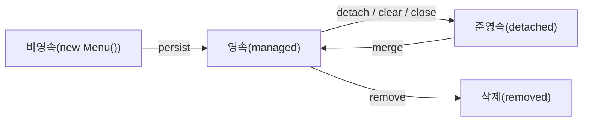

Spring MVC를 마무리하고 바로 JPA로 넘어간 날. JDBC를 직접 쓸 때 반복해서 겪었던 4가지 문제를 다시 정리하고, JPA가 그걸 영속성 컨텍스트로 어떻게 해결하는지 배운 학습 노트다.

<!--more-->

## JDBC를 다시 돌아보다 (Situation)

JDBC 챕터에서 Connection·Statement·ResultSet을 직접 다루는 법을 배웠는데, 오늘은 그 방식을 "문제점 4가지"로 다시 정리하는 것부터 시작했다. 그리고 바로 이어서 **JPA(Java Persistence API)**가 그 문제들을 어떻게 해결하는지 같은 시나리오로 비교했다.

## 배운 내용 (Task)

목표는 JDBC를 직접 쓸 때 반복되는 코드, SQL 중심 개발, 객체-관계 패러다임 불일치, 동일성 보장 문제를 코드로 다시 겪어보고, JPA의 `EntityManager`가 그 문제들을 어떻게 해결하는지 확인하는 것, 그리고 영속성 컨텍스트가 CRUD를 처리하는 방식(특히 Dirty Checking)과 엔티티의 생명주기(비영속-영속-준영속-삭제)를 이해하는 것이었다.

## 정리한 내용 (Action)

### JDBC의 4가지 고질병

```java
// 1. 조회할 때마다 Connection, Statement, ResultSet 코드가 반복된다
try (Connection con = dataSource.getConnection();
     Statement stmt = con.createStatement();
     ResultSet rset = stmt.executeQuery(query)) {
    while (rset.next()) {
        Menu menu = new Menu();
        menu.setMenuCode(rset.getInt("menu_code"));
        // ... 필드 하나하나 옮겨 담기
    }
}
```

**1. 반복 코드** — 조회 하나 추가할 때마다 이 패턴을 거의 그대로 복붙해야 했다. **2. SQL 중심 개발** — "카테고리 이름도 같이 보여주세요"라는 요구사항 하나에 SQL JOIN, 새 DTO, 매핑 코드까지 연쇄적으로 바뀌었다. **3. 패러다임 불일치** — `Menu` 객체는 `categoryCode`라는 "값"만 갖고 있어서 `menu.getCategory()`처럼 객체를 탐색할 수 없고, 카테고리가 필요하면 SQL을 한 번 더 날려야 했다. 그리고 **4. 동일성 보장 문제**가 가장 인상 깊었다.

```java
Menu menu1 = findMenuByMenuCode(menuCode);
Menu menu2 = findMenuByMenuCode(menuCode);

System.out.println("menu1 == menu2 : " + (menu1 == menu2));  // false!

menu1.setMenuName("이름 변경 테스트");
// menu2 는 menu1 의 변경을 전혀 알아차리지 못한다.
```

**같은 행을 두 번 조회했는데 완전히 다른 객체가 나온다** — 한쪽을 바꿔도 다른 쪽은 그대로다. DB에선 분명 같은 데이터인데 자바 객체로는 "같다"고 보장할 방법이 없었다.

### JPA가 같은 문제를 푸는 법

```java
@Entity
@Table(name = "tbl_menu")
public class Menu {
    @Id
    @Column(name = "menu_code")
    private int menuCode;

    @ManyToOne
    @JoinColumn(name = "category_code")
    private Category category;   // FK 값이 아니라 객체 자체를 필드로!
}
```

```java
@PersistenceContext
private EntityManager manager;

public void findMenu(int menuCode) {
    Menu foundMenu = manager.find(Menu.class, menuCode);  // SQL도, 매핑 코드도 안 보인다
}
```

`@Entity`로 선언한 클래스는 `manager.find()` 한 줄로 조회되고, **SQL 작성과 ResultSet 매핑을 JPA가 대신** 해준다(문제 1 해결). 연관된 테이블은 `@ManyToOne`으로 **FK 값이 아니라 `Category` 객체 자체를 필드로** 가질 수 있어서, 객체 그래프를 그대로 탐색할 수 있었다(문제 2·3 해결).

```java
@Transactional(readOnly = true)
public void compareSameMenu(int menuCode) {
    Menu menu1 = manager.find(Menu.class, menuCode);
    Menu menu2 = manager.find(Menu.class, menuCode);

    System.out.println("menu1 == menu2 : " + (menu1 == menu2));  // true!
    menu1.changeMenuName("테스트!");
    System.out.println("menu2 = " + menu2.getMenuName());  // "테스트!" 로 같이 바뀜
}
```

**같은 트랜잭션 안에서 같은 PK로 조회한 엔티티는 항상 같은 객체(`==`)를 반환**한다는 걸 직접 확인했다(문제 4 해결). 비밀은 바로 다음에 배운 **영속성 컨텍스트의 1차 캐시**에 있었다.

### 영속성 컨텍스트 — persist해도 SQL이 바로 안 나간다

```java
EntityTransaction transaction = manager.getTransaction();
transaction.begin();
try {
    manager.persist(menu);      // 바로 INSERT가 안 나간다!
    transaction.commit();       // commit 시점에 flush → 그제서야 INSERT 전송
} catch (Exception e) {
    transaction.rollback();
}
```

`persist()`를 호출해도 **"쓰기 지연 SQL 저장소"에 SQL을 모아뒀다가, `commit()` 시점에 flush되면서 한꺼번에 DB로 전송**된다는 게 신기했다. 콘솔에 INSERT 구문이 찍히는 타이밍을 직접 확인하면서 "아, 호출 순서랑 실제 SQL 전송 순서가 다를 수 있구나"를 체감했다.

### Dirty Checking — Update 메소드가 없다?!

```java
Menu foundMenu = manager.find(Menu.class, menuCode);

transaction.begin();
foundMenu.setMenuName(menuName);  // setter만 호출했을 뿐인데
transaction.commit();              // UPDATE 쿼리가 자동으로 나간다!
```

`EntityManager`에는 `update()` 메소드가 아예 없었다. 대신 **엔티티를 조회하는 순간 그 상태를 스냅샷으로 저장해두고, commit 시점에 현재 값과 스냅샷을 비교해서 바뀐 부분만 UPDATE 쿼리를 자동 생성**하는 **변경 감지(Dirty Checking)**가 그 자리를 대신하고 있었다. `setter`만 호출하면 끝이라는 게 JDBC의 `executeUpdate()`를 직접 호출하던 것과 완전히 다른 느낌이었다.

### 엔티티 생명주기 4단계



```java
// 영속(managed): find()로 조회하면 1차 캐시에 들어간다
Menu foundMenu = manager.find(Menu.class, menuCode);
System.out.println(manager.contains(foundMenu));  // true

// 준영속(detached): detach 후에는 변경해도 UPDATE가 안 나간다
manager.detach(foundMenu);
foundMenu.setMenuPrice(foundMenu.getMenuPrice() + 1000);  // 변경 감지 대상 아님

// merge: 준영속 엔티티의 값을 "영속 상태의 새 엔티티"로 복사
Menu mergedMenu = manager.merge(detachMenu);
System.out.println(detachMenu == mergedMenu);  // false! 복사된 다른 객체다
```

`detach()`한 엔티티는 아무리 setter를 호출해도 **변경 감지가 동작하지 않는다**는 걸 직접 겪었고, `merge()`는 "준영속 엔티티 자체를 영속 상태로 되돌리는 게 아니라, 그 값을 복사한 **새로운 영속 엔티티**를 반환한다"는 게 가장 헷갈렸던 부분이다 — `detachMenu == mergedMenu`가 `false`로 나오는 걸 보고서야 확실히 이해됐다.

## 결과 (Result)

JDBC에서 겪었던 4가지 문제(반복 코드, SQL 중심 개발, 패러다임 불일치, 동일성 보장)를 JPA가 `EntityManager`와 영속성 컨텍스트로 어떻게 해결하는지 1:1로 대응시켜 이해했다. 특히 "update 메소드가 없다"는 사실이 Dirty Checking의 존재를 가장 강렬하게 각인시켰고, 비영속-영속-준영속-삭제라는 생명주기와 flush·merge의 동작을 직접 로그로 확인하면서 JPA가 "마법처럼 알아서 해주는" 게 아니라 명확한 규칙으로 동작한다는 걸 알게 됐다.

## 더 학습하면 좋은 개념

- **영속성 전이(Cascade)와 고아 객체 제거(orphanRemoval)** — 오늘은 `Menu` 혼자만 다뤘는데, 연관된 엔티티(`Category`)까지 같이 저장/삭제하려면 어떤 옵션이 필요한지 다음에 배워야 한다.
- **지연 로딩(Lazy) vs 즉시 로딩(Eager)** — `@ManyToOne`으로 연관 엔티티를 필드로 가지면, 그 연관 엔티티를 언제 실제로 조회해올지(즉시 vs 필요한 시점에)가 성능에 큰 영향을 준다고 들었는데 오늘은 다루지 않았다.
- **JPQL** — 오늘은 `find()`로 PK 조회만 했는데, 조건이 복잡한 조회는 어떻게 하는지(JPQL이라는 객체지향 쿼리 언어가 있다고 들었다) 다음 단계에서 배워야 한다.

## 참고 자료

- [Jakarta Persistence 공식 문서](https://jakarta.ee/specifications/persistence/3.1/)
- [Spring Data JPA 공식 문서 - Core Concepts](https://docs.spring.io/spring-data/jpa/reference/jpa/getting-started.html)
