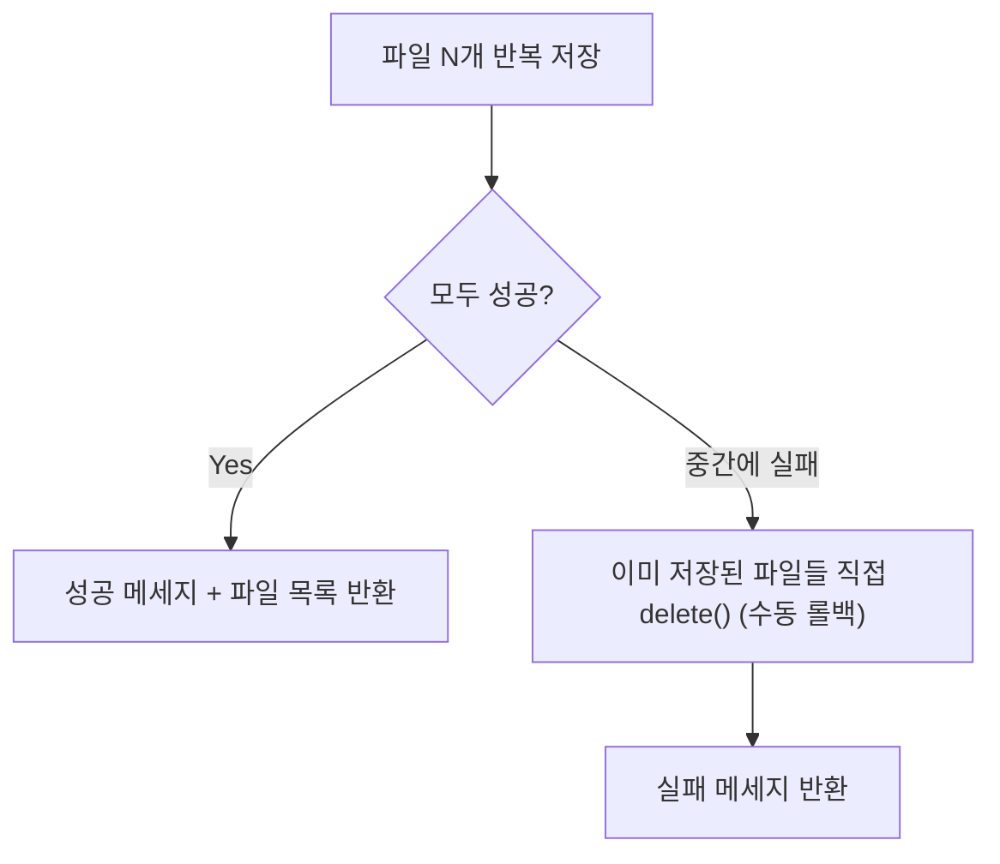

Spring MVC의 마지막 두 챕터. 파일을 업로드할 때 왜 "트랜잭션처럼" 생각해야 하는지, 그리고 JSP 대신 쓰는 Thymeleaf의 표현식·조건문·반복문·Fragment까지 정리한 학습 노트다.

<!--more-->

## MVC의 마지막 조각들 (Situation)

MVC 패턴의 핵심(요청 매핑, 예외, 인터셉터)을 다뤘으니, 오늘은 실전에서 자주 쓰는 두 가지 — **파일 업로드**와 **화면 템플릿(Thymeleaf)**을 배웠다. 특히 파일 업로드에서 "여러 파일 중 하나만 실패하면 어떻게 할 것인가"라는 질문이, 지난번 MySQL 트랜잭션 글에서 배운 개념과 바로 연결됐다.

## 배운 내용 (Task)

목표는 `MultipartFile`로 업로드된 파일을 UUID 기반 이름으로 저장하고 정적 리소스로 서빙하는 법, 여러 파일 업로드 중 일부가 실패했을 때 이미 저장된 파일을 되돌리는 법, 그리고 Thymeleaf의 표현식(`${}`, `*{}`, `@{}`)과 `th:if`/`th:each`, Fragment(`th:replace`/`th:insert`)로 화면을 조립하는 법을 익히는 것이었다.

## 정리한 내용 (Action)

### 파일 업로드 — 원본 이름을 믿으면 안 되는 이유

```java
private String save(MultipartFile file) throws IOException {
    String originName = file.getOriginalFilename();          // test.png
    String ext = originName.substring(originName.lastIndexOf(".")).toLowerCase();

    // 중복 방지를 위해 원본 이름 대신 UUID로 저장
    String savedName = UUID.randomUUID().toString() + ext;

    File dir = new File(uploadDir).getAbsoluteFile();
    dir.mkdirs();
    file.transferTo(new File(dir, savedName));

    return savedName;
}
```

같은 이름의 파일(`스크린샷.png`)을 여러 명이 올리면 **원본 파일명 그대로 저장했다간 서로 덮어쓴다**는 문제부터 짚었다. `UUID.randomUUID()`로 저장 이름을 새로 만들고, 화면에 보여줄 땐 원본 이름을 DTO에 별도로 담아두는 방식으로 해결했다.

```java
@Override
public void addResourceHandlers(ResourceHandlerRegistry registry) {
    // 요청 URL(/uploads/**)과 실제 저장 폴더를 연결
    registry.addResourceHandler("/uploads/**")
            .addResourceLocations("file:" + uploadDir + "/");
}
```

업로드된 파일을 ``처럼 다시 보여주려면, `WebMvcConfigurer.addResourceHandlers()`로 **URL 패턴과 실제 디스크 경로를 연결**해줘야 한다는 것도 새로 배웠다.

### 멀티 파일 업로드 — "트랜잭션처럼" 롤백하기

```java
List<FileDTO> files = new ArrayList<>();
try {
    for (MultipartFile file : multipartFile) {
        String savedName = save(file);
        files.add(new FileDTO(file.getOriginalFilename(), savedName, uploadDir, description));
    }
    mv.addObject("message", "멀티 파일 업로드 성공!");
} catch (Exception e) {
    // 5개 중 4개는 저장되고 1개가 실패하면?
    // Transaction의 rollback처럼, 이전에 저장된 파일들을 전부 삭제한다
    for (FileDTO file : files) {
        new File(new File(uploadDir).getAbsoluteFile(), file.getSavedName()).delete();
    }
    mv.addObject("message", "멀티 파일 업로드 실패!");
}
```

여러 파일을 반복문으로 저장하다가 중간에 하나가 실패하면, **이미 디스크에 저장된 파일들만 남고 DB(또는 응답)에는 실패로 기록되는 불일치**가 생길 수 있다. 코드 주석에 그대로 적혀 있던 것처럼, 이건 정확히 지난번 MySQL에서 배운 "계좌이체 중 하나라도 실패하면 전부 롤백"하는 트랜잭션 개념과 같은 문제였다 — 다만 DB가 아니라 **파일 시스템이라 롤백을 직접 코드로 구현**해야 했다. `catch` 블록에서 그때까지 저장된 파일을 순회하며 직접 `delete()`하는 방식으로 "수동 롤백"을 구현했다.



### Thymeleaf — 표현식으로 데이터를 화면에 꽂기

```html
<p th:text="${ param.title }"></p>           <!-- 쿼리스트링 -->
<p th:object="${ member }" th:text="*{ age }"></p>   <!-- th:object로 선택한 객체의 필드 -->
<a th:href="@{/lecture/expression(title='링크', no=1)}">파라미터를 포함한 링크</a>
```

변수 표현식 `${}`(Model에 담은 값), 선택 변수식 `*{}`(`th:object`로 선택해둔 객체의 필드), 링크 표현식 `@{}`(URL, 쿼리스트링까지 조립)를 구분해서 썼다. **`th:text`와 `th:utext`의 차이**도 중요했다 — `th:text`는 태그를 이스케이프해서 문자열 그대로 보여주고, `th:utext`는 이스케이프하지 않아서 `<h3>` 같은 태그가 실제로 렌더링된다. 대신 `th:utext`는 사용자가 입력한 값을 그대로 쓰면 **XSS 공격에 취약**해질 수 있어서 기본은 `th:text`를 쓰고, 신뢰할 수 있는 값에만 `th:utext`를 써야 한다는 것도 같이 배웠다.

### th:if / th:each — 제어문도 속성으로

```html
<p th:if="${ num > 0 and num <= 10 }">1부터 10까지의 양수</p>

<tr th:each="member, stat : ${ memberList }">
    <td th:text="${ member.name }"></td>
    <td th:text="${ stat.count }"></td>      <!-- 1부터 시작 -->
    <td th:text="${ stat.even }"></td>       <!-- 짝수 번째 여부 -->
</tr>
```

자바의 if/for가 HTML 태그의 **속성(attribute)으로 그대로 들어간다**는 게 Thymeleaf의 핵심이었다. `th:each`에 `member, stat`처럼 상태 변수를 같이 선언하면 `index`/`count`/`even`/`odd`/`first`/`last`까지 반복 상태를 바로 꺼내 쓸 수 있어서, 짝수/홀수 행마다 다른 스타일을 주는 것 같은 처리가 쉬워졌다.

### Fragment — 공통 레이아웃 조각내기

```html
<!-- th:replace: 태그 자체(내부 포함)를 통째로 Fragment로 교체 -->
<header th:replace="~{common/header :: headerFragment}">
    <h1>나는 header</h1>
</header>

<!-- th:insert: 바깥 태그는 유지, 안쪽만 Fragment로 채움 -->
<footer th:insert="~{common/footer :: footerFragment}">
    <h2>나는 footer</h2>
</footer>
```

header·footer·aside를 각 페이지마다 복붙하는 대신, 템플릿 조각으로 분리해서 가져다 쓰는 방법이었다. **`th:replace`는 태그째로 바꾸고, `th:insert`는 바깥 태그를 남긴 채 안쪽만 채운다**는 차이를 결과 HTML을 직접 비교해보고 구분했다. `common/aside :: asideFragment(${test1}, ${test2})`처럼 Fragment에 파라미터를 전달할 수도 있어서, 공통 조각이라도 페이지마다 다른 값을 보여줄 수 있었다.

## 결과 (Result)

파일 업로드에서는 원본 파일명을 그대로 믿지 않고 UUID로 재명명해야 하는 이유와, 여러 파일 중 하나가 실패했을 때 "파일 시스템에서의 수동 롤백"이 필요하다는 걸 MySQL 트랜잭션 개념과 연결 지어 이해했다. Thymeleaf에서는 표현식 종류별 용도, `th:text`/`th:utext`의 보안 차이, `th:each`의 상태 변수, 그리고 `th:replace`/`th:insert`로 레이아웃을 재사용하는 법까지 화면을 구성하는 데 필요한 핵심 문법을 하루에 훑었다.

## 더 학습하면 좋은 개념

- **파일 업로드 용량 제한과 검증** — 오늘은 파일 크기·확장자 검증을 다루지 않았는데, 실제로는 `spring.servlet.multipart.max-file-size` 같은 설정과 확장자 화이트리스트가 꼭 필요하다고 들었다.
- **레이아웃 Dialect(thymeleaf-layout-dialect)** — 오늘 배운 Fragment 방식 말고, `layout:decorate` 같은 별도 라이브러리로 레이아웃을 관리하는 방법도 있다고 들어서 비교해보면 좋겠다.
- **인라인 자바스크립트의 내추럴 템플릿** — `let hello = /*[[${ hello }]]*/ '기본값';` 패턴이 정적/동적 페이지 모두에서 문법 오류 없이 동작하는 이유를, Thymeleaf 공식 문서에서 더 정확히 짚어보고 싶다.

## 참고 자료

- [Spring 공식 문서 - Multipart Resolver](https://docs.spring.io/spring-framework/reference/web/webmvc/mvc-servlet/multipart.html)
- [Thymeleaf 공식 문서 - Tutorial: Using Thymeleaf](https://www.thymeleaf.org/doc/tutorials/3.1/usingthymeleaf.html)
- [OWASP - Cross Site Scripting Prevention](https://cheatsheetseries.owasp.org/cheatsheets/Cross_Site_Scripting_Prevention_Cheat_Sheet.html)
