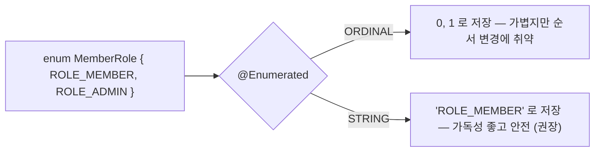

Menu 엔티티로 JPA의 기본 흐름을 익혔다면, 오늘은 회원(Member) 엔티티로 넘어가 테이블과 자바 객체를 세밀하게 맞추는 어노테이션들을 배웠다. PK 생성 전략, 컬럼 제약조건, enum 매핑까지 정리한 학습 노트다.

<!--more-->

## Menu에서 Member로 (Situation)

어제 JPA의 기본 동작(영속성 컨텍스트, Dirty Checking, 생명주기)을 Menu 엔티티로 배웠다면, 오늘은 좀 더 복잡한 Member 엔티티로 넘어가 **엔티티를 테이블에 정확히 매핑하는 세부 어노테이션**들을 배웠다. 그리고 DAO라고 부르던 계층이 JPA에서는 어떻게 불리는지도 짚었다.

## 배운 내용 (Task)

목표는 `@GeneratedValue`의 PK 생성 전략(IDENTITY, SEQUENCE, TABLE, AUTO)의 차이, `@Column`의 제약조건 속성들이 DDL에 어떻게 반영되는지, `@Enumerated`로 enum을 매핑할 때 ORDINAL과 STRING의 차이, 그리고 Service-Repository 계층에서 `@Transactional`이 어디에 걸려야 하는지를 이해하는 것이었다.

## 정리한 내용 (Action)

### @GeneratedValue — PK를 누가 만드는가

```java
@Id
@Column(name = "member_no")
@GeneratedValue(strategy = GenerationType.IDENTITY)
private int memberNo;
```

| 전략 | PK 생성 주체 | INSERT 시점 |
|------|-------------|------------|
| IDENTITY | DB의 AUTO_INCREMENT | `persist()` 즉시 (쓰기 지연 불가) |
| SEQUENCE | DB의 시퀀스 객체 | PK는 미리 받고, INSERT는 flush 시점 |
| TABLE | 키 생성 전용 테이블 | - |
| AUTO | DB에 맞춰 자동 선택 | - |

MySQL을 쓰니 `IDENTITY` 전략을 썼는데, 어제 배운 "쓰기 지연 SQL 저장소"가 **IDENTITY 전략에서는 동작하지 않는다**는 게 새로웠다 — DB가 INSERT를 실행해야만 PK 값을 알 수 있으니, `persist()`를 호출하는 즉시 INSERT가 나가야 했다. SEQUENCE는 PK를 미리 받아올 수 있어서 쓰기 지연이 그대로 유지된다는 차이도 확인했다.

### @Column — 제약조건이 DDL로 그대로 반영된다

```java
@Column(name = "member_id", nullable = false,
        unique = true, columnDefinition = "varchar(10)")
private String memberId;

@Column(name = "address", length = 900)
private String address;

@Column(name = "status", columnDefinition = "char(1) default 'Y'")
private String status;
```

지난 MySQL 글에서 배운 NOT NULL, UNIQUE 같은 제약조건을 **자바 어노테이션 속성으로 그대로 선언**할 수 있었다 — `nullable = false`가 `NOT NULL`로, `unique = true`가 `UNIQUE`로, `columnDefinition`은 컬럼 타입·기본값까지 직접 지정해서 DDL에 반영됐다. JPA가 엔티티로 테이블을 만들어줄 때(`ddl-auto`) 이 속성들을 그대로 읽어서 `CREATE TABLE` 구문을 만든다는 걸 알고 나니, MySQL DDL 챕터에서 손으로 썼던 제약조건을 자바 쪽에서 선언하는 느낌으로 이해됐다.

### @Enumerated — ORDINAL이냐 STRING이냐

```java
public enum MemberRole {
    ROLE_MEMBER, ROLE_ADMIN;
}
```

```java
@Column(name = "member_role")
@Enumerated(EnumType.STRING)
private MemberRole memberRole;
```

enum을 DB에 저장하는 방법이 두 가지였다. **ORDINAL**은 enum 순서(0, 1, ...)를 숫자로 저장해서 가볍지만, **나중에 enum 사이에 값을 추가하거나 순서를 바꾸면 기존 데이터의 의미가 통째로 틀어진다**는 치명적인 단점이 있었다. **STRING**은 이름 그대로("ROLE_ADMIN") 저장해서 용량은 조금 더 쓰지만 순서 변경에 안전하고 가독성도 좋아서, **실무에서는 STRING을 권장**한다는 걸 배웠다. Hibernate 6 + MySQL 조합에서는 STRING으로 매핑하면 컬럼이 아예 MySQL의 `enum('ROLE_ADMIN','ROLE_MEMBER')` 타입으로 생성된다는 것도 실제 DDL을 보고 확인했다.



### DAO에서 Repository로 — 이름이 바뀐 이유

```java
@Repository
public class MemberRepository {
    @PersistenceContext
    private EntityManager manager;

    public void save(Member member) {
        manager.persist(member);
    }

    public Member findByMemberNo(int memberNo) {
        return manager.find(Member.class, memberNo);
    }
}
```

JDBC 챕터에서 `MenuDAO`라고 부르던 "DB 접근 계층"이, Spring + JPA 환경에서는 관례적으로 **Repository**라는 이름으로 불린다는 걸 배웠다. 역할은 동일했다 — SQL을 직접 실행하던 자리를 `EntityManager.persist()`/`find()`가 대신할 뿐, "비즈니스 로직 없이 데이터 접근만 책임진다"는 계층의 본질은 그대로였다.

```java
@Service
public class MemberService {
    @Transactional
    public int registMember(MemberRegistDTO dto) {
        Member member = new Member(/* DTO -> Entity 변환 */);
        memberRepository.save(member);
        return member.getMemberNo();
    }

    @Transactional(readOnly = true)
    public MemberRegistDTO findByMemberNo(int memberNo) { /* Entity -> DTO 변환 */ }
}
```

`@Transactional`을 Repository가 아니라 **Service 메소드에 붙인다**는 점도 중요했다 — 하나의 비즈니스 로직 안에서 Repository 메소드를 여러 번 호출할 수도 있는데, 그 전체가 하나의 트랜잭션 단위여야 하기 때문이다. 조회 전용 메소드에는 `readOnly = true`를 붙여서 **불필요한 변경 감지(Dirty Checking)를 생략**하게 했다.

## 결과 (Result)

PK 생성 전략에 따라 쓰기 지연이 가능한지 여부가 달라진다는 것, `@Column` 속성이 MySQL DDL의 제약조건으로 그대로 이어진다는 것, 그리고 enum을 STRING으로 매핑하는 게 왜 안전한 선택인지 이해했다. DAO가 Repository로 이름이 바뀐 배경과, `@Transactional`이 Service 계층에 있어야 하는 이유까지 정리하면서, JPA 환경에서 레이어드 아키텍처가 JDBC 때와 어떻게 달라지는지 감이 잡혔다.

## 더 학습하면 좋은 개념

- **Checked 예외 vs Unchecked 예외와 `@Transactional`** — `MemberService` 코드에 내가 직접 "블로그 작성 키워드"로 메모해둔 내용인데, `@Transactional`은 기본적으로 **RuntimeException(Unchecked)에서만 자동 rollback**되고 Checked 예외에서는 rollback되지 않는다고 들었다. 왜 그런지, `rollbackFor` 옵션으로 어떻게 바꾸는지 다음에 꼭 정리해야 한다.
- **`@Transactional`의 전파(Propagation)** — 이것도 같이 메모해둔 키워드다. 트랜잭션이 걸린 메소드가 트랜잭션이 걸린 다른 메소드를 호출하면 어떻게 되는지(기존 트랜잭션에 참여하는지, 새로 만드는지) 전파 옵션을 알아봐야 한다.
- **Spring Data JPA의 `JpaRepository`** — 오늘은 `EntityManager`를 직접 주입받아 Repository를 손으로 짰는데, `JpaRepository`를 상속하기만 하면 기본 CRUD 메소드가 자동 생성된다는 걸 들었다. 다음에 비교해보고 싶다.

## 참고 자료

- [Jakarta Persistence 공식 문서 - @GeneratedValue](https://jakarta.ee/specifications/persistence/3.1/jakarta-persistence-spec-3.1.html#a2041)
- [Spring 공식 문서 - Transaction Management](https://docs.spring.io/spring-framework/reference/data-access/transaction.html)
