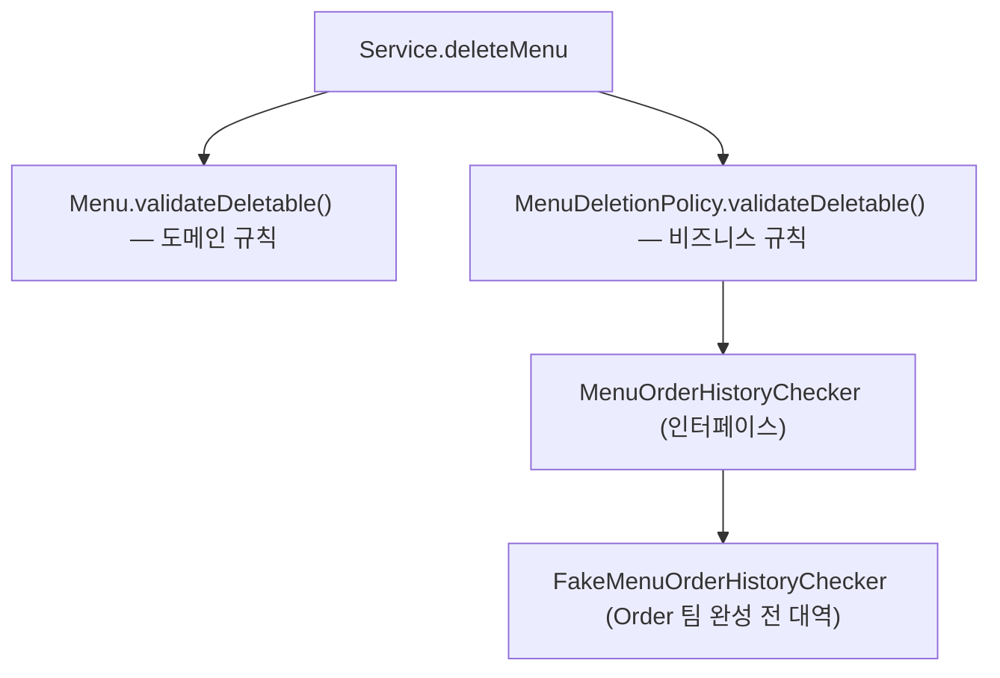

JPA 마지막 날은 미니 프로젝트. "Service가 규칙까지 다 판단하면 생기는 문제"를 직접 Before/After로 겪어보면서, 도메인 규칙은 Entity에게, 비즈니스 규칙은 Policy에게 넘기는 법을 배운 학습 노트다.

<!--more-->

## 메뉴 등록/삭제 기능 하나를 제대로 설계해보기 (Situation)

11/4부터 이어온 JPA 미니 프로젝트. 메뉴(Menu)와 카테고리(Category)를 `JpaRepository`로 연결하는 기본 세팅에서 시작해서, 오늘은 "메뉴 등록·수정·삭제" 기능을 **Service가 모든 if문을 떠안는 버전**과 **Entity·Policy로 책임을 나눈 버전**, 두 가지로 직접 비교하며 리팩터링했다.

## 배운 내용 (Task)

목표는 `JpaRepository`와 쿼리 메소드로 Repository를 선언만으로 완성하는 법, "Service가 규칙까지 다 판단하면" 생기는 문제를 Before 코드로 직접 보고, 도메인 규칙(자기 상태로 판단 가능한 것)은 Entity에게, 비즈니스 규칙(다른 데이터 조회가 필요한 것)은 Policy에게 위임하는 설계를 적용하는 것, 그리고 팀 간 의존 방향을 끊어내는 인터페이스 기반 "계약"을 이해하는 것이었다.

## 정리한 내용 (Action)

### JpaRepository — 선언만 하면 구현체가 생긴다

```java
@Repository
public interface MenuRepository extends JpaRepository<Menu, Integer> {
    // 쿼리 메소드: 메소드 이름 그대로 SQL이 만들어진다
    List<Menu> findByMenuPriceGreaterThanOrderByMenuPrice(int menuPrice);
    boolean existsByMenuName(String menuName);
}
```

```java
@Repository
public interface CategoryRepository extends JpaRepository<Category, Integer> {
    // 쿼리 메소드로 표현하기 힘든 조회는 @Query로 직접 SQL
    @Query(value = "select * from tbl_category where ref_category_code is not null order by category_code",
           nativeQuery = true)
    List<Category> findSubCategory();
}
```

지난 글에서 "다음에 `JpaRepository`를 비교해보고 싶다"고 적어뒀는데, 오늘 바로 써봤다. `EntityManager`를 직접 주입받아 `save()`/`find()`를 손으로 짜던 것과 달리, **인터페이스 하나 선언하고 상속만 받으면 기본 CRUD가 전부 생긴다**는 게 신기했다. 메소드 이름 규칙(`findByXxxGreaterThanOrderByYyy`)만 맞추면 쿼리를 안 짜도 되는 **쿼리 메소드**와, 복잡한 조회는 `@Query`로 JPQL 또는 네이티브 SQL을 직접 쓰는 방식을 구분해서 익혔다.

### Before — Service가 모든 걸 다 판단하면

```java
@Transactional
public void deleteMenu(int menuCode) {
    Menu foundMenu = menuRepository.findById(menuCode).orElseThrow(...);

    // ① 도메인 규칙: Service가 "Y"라는 내부 표현을 직접 알아야 한다
    if ("Y".equals(foundMenu.getOrderableStatus())) {
        throw new BusinessException(ErrorCode.ON_SALE_MENU_CANNOT_DELETE);
    }
    // ② 비즈니스 규칙: 다른 팀(Order)의 Repository를 직접 의존
    if (orderMenuRepository.existsByMenuCode(menuCode)) {
        throw new BusinessException(ErrorCode.ORDERED_MENU_CANNOT_DELETE);
    }
    menuRepository.delete(foundMenu);
}
```

이 코드의 문제를 직접 짚어봤다 — **①**은 Service가 `"Y"`가 "판매중"이라는 Menu의 내부 표현을 알아야 하고, **②**는 Order 팀의 Repository를 Menu 팀이 직접 의존해서 **팀 간 경계가 무너진다.** 등록(`registNewMenu`)과 수정(`modifyMenuName`)에도 "이름 중복 금지" 규칙이 복사되어 있어서, 규칙이 하나 바뀌면 여러 메소드를 찾아다니며 고쳐야 하는 구조였다.

### After — Entity는 자기 상태를, Policy는 다른 데이터를

```java
// Entity: 자기 값만으로 판단 가능한 "도메인 규칙"
public void validateDeletable() {
    if (this.orderableStatus.equals(ON_SALE)) {
        throw new BusinessException(ErrorCode.ON_SALE_MENU_CANNOT_DELETE);
    }
}
```

```java
// Policy: 다른 데이터(주문 이력)를 조회해야 판단 가능한 "비즈니스 규칙"
@Component
@RequiredArgsConstructor
public class MenuDeletionPolicy {
    private final MenuOrderHistoryChecker menuOrderHistoryChecker;

    public void validateDeletable(int menuCode) {
        if (menuOrderHistoryChecker.hasOrdered(menuCode)) {
            throw new BusinessException(ErrorCode.ORDERED_MENU_CANNOT_DELETE);
        }
    }
}
```

```java
@Transactional
public void deleteMenu(int menuCode) {
    Menu found = menuRepository.findById(menuCode).orElseThrow(() -> new BusinessException(ErrorCode.MENU_NOT_FOUND));

    found.validateDeletable();                 // 도메인 규칙은 Entity에게
    menuDeletionPolicy.validateDeletable(menuCode);  // 비즈니스 규칙은 Policy에게
    menuRepository.delete(found);               // Service엔 "흐름"만 남는다
}
```

판단 기준은 명확했다 — **"다른 데이터를 조회해야만 알 수 있는가?"** 아니면 Entity, 맞으면 Policy. `deleteMenu()`에는 더 이상 if문이 없고, **조회 → 규칙 확인 → 삭제라는 3줄의 흐름만** 남았다. 카테고리도 마찬가지로, `MenuCategoryPolicy`가 `category.isSubCategory()`라고 **Category에게 직접 물어보고**, `refCategoryCode == null` 같은 내부 구조를 Service나 Policy가 해석하지 않게 했다.



### 팀 경계를 끊는 인터페이스 — 의존성 역전

```java
// Menu 팀이 정의한 "계약" — Order 팀 Entity/Repository를 전혀 모른다
public interface MenuOrderHistoryChecker {
    boolean hasOrdered(int menuCode);
}

// Order 팀이 아직 없을 때 쓰는 가짜 구현
@Component
public class FakeMenuOrderHistoryChecker implements MenuOrderHistoryChecker {
    private static final Set<Integer> ORDERED_MENU_CODES = Set.of(1, 2, 3);

    @Override
    public boolean hasOrdered(int menuCode) {
        return ORDERED_MENU_CODES.contains(menuCode);
    }
}
```

Spring Core에서 배운 결제 게이트웨이 예제(`PaymentInterface`)가 여기서도 그대로 등장했다. **Menu 팀이 필요한 기능을 인터페이스로 "주문"하고, Order 팀이 그 인터페이스를 구현**하는 방식이라서, 실제 Order 도메인이 아직 없어도 `Fake` 구현체로 먼저 개발·테스트를 진행할 수 있었다. 나중에 진짜 구현체가 생기면 `FakeMenuOrderHistoryChecker`만 지우면 되고, **`MenuDeletionPolicy` 코드는 한 줄도 안 바뀐다**는 게 핵심이었다.

### 예외는 RuntimeException으로 — 지난 궁금증의 답

```java
public class BusinessException extends RuntimeException {
    private final ErrorCode errorCode;
    public BusinessException(ErrorCode errorCode) {
        super(errorCode.getMessage());
        this.errorCode = errorCode;
    }
}
```

어제 Member 글에 "Checked/Unchecked 예외와 `@Transactional`을 다음에 정리해야 한다"고 적어뒀는데, 오늘 쓴 `BusinessException`이 그 답의 일부였다. `RuntimeException`(Unchecked)을 상속했기 때문에 `throws` 선언 없이 Controller까지 전파되고, **`@Transactional`이 걸린 메소드 안에서 발생하면 자동으로 rollback**된다. 반대로 `Exception`(Checked)을 상속했다면 기본 설정에서는 rollback되지 않는다는 것까지는 이번에 확인했다.

## 결과 (Result)

Service가 모든 if문을 떠안은 Before 코드와, Entity·Policy로 책임을 나눈 After 코드를 직접 비교하면서 "다른 데이터를 조회해야 하는가"라는 기준 하나로 어디에 규칙을 둘지 판단하는 법을 익혔다. 인터페이스로 팀 간 의존 방향을 역전시키는 패턴을 Spring Core의 DI 예제와 연결 지어 이해했고, `BusinessException`을 RuntimeException으로 만든 이유도 어제 남겨둔 궁금증의 답으로 확인했다. 다만 `Menu.stopSelling()`/`resumeSelling()`과 `MenuNamePolicy.validateRename()`은 아직 TODO로 남겨뒀다 — 다음에 마저 채워야 한다.

## 더 학습하면 좋은 개념

- **`stopSelling()`/`resumeSelling()` 직접 완성하기** — `validateDeletable()`과 같은 패턴(자기 상태 확인 후 예외 또는 상태 변경)으로 짜면 될 것 같은데, 아직 코드로 옮기지 못했다. 다음에 제일 먼저 끝내야 할 숙제다.
- **동시성 문제(Race Condition)** — `MenuNamePolicy` 주석에 "동시에 2명이 같은 이름을 등록하면 둘 다 통과할 수 있다"고 적어뒀다. 애플리케이션 레벨 검증만으로는 완벽하지 않고, DB에 `UNIQUE` 제약조건을 같이 걸어야 한다는 걸 MySQL 챕터와 연결해서 더 봐야 한다.
- **단위 테스트에서 Fake 활용하기** — `FakeMenuOrderHistoryChecker`가 테스트에도 쓰일 수 있다고 주석에 적혀 있었는데, 오늘은 실제 테스트 코드까지는 작성하지 못했다. Mockito 같은 도구 없이도 인터페이스 기반 설계만으로 테스트가 쉬워진다는 걸 직접 코드로 짜보고 싶다.

## 참고 자료

- [Spring Data JPA 공식 문서 - Query Methods](https://docs.spring.io/spring-data/jpa/reference/jpa/query-methods.html)
- [Martin Fowler - AnemicDomainModel](https://martinfowler.com/bliki/AnemicDomainModel.html)
- [Spring 공식 문서 - Transaction rollback rules](https://docs.spring.io/spring-framework/reference/data-access/transaction/declarative/rolling-back.html)
