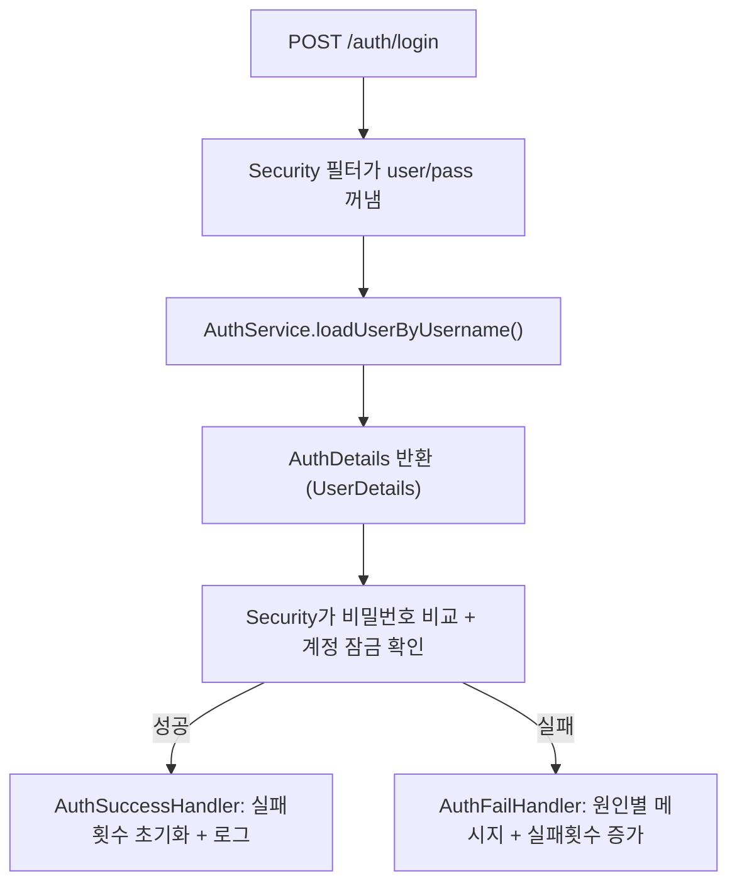

지금까지 로그인은 항상 Controller가 직접 처리했는데, Spring Security를 쓰면 `POST /auth/login`을 받는 컨트롤러를 아예 만들지 않는다. 필터가 로그인을 가로채는 흐름과, 성공/실패 핸들러를 배운 학습 노트다.

<!--more-->

## 로그인 Controller를 안 만든다?! (Situation)

Servlet·MVC에서는 로그인 요청을 받는 `@PostMapping`을 늘 직접 짰는데, 오늘 Spring Security를 배우면서 가장 먼저 충격받은 게 **"POST /auth/login을 처리하는 컨트롤러는 우리가 만들지 않는다"**는 점이었다. `SecurityFilterChain`이 그 요청을 가로채서 아이디/비밀번호 검증까지 전부 대신 해준다.

## 배운 내용 (Task)

목표는 `SecurityFilterChain`으로 URL별 접근 권한, 로그인 폼, 자동 로그인, 로그아웃, 세션 정책을 선언하는 법, `UserDetailsService`/`UserDetails`로 우리 DB의 회원 정보를 Security가 이해하는 형태로 연결하는 법, 그리고 로그인 성공/실패 시 추가 동작(실패 횟수 관리, 로그 저장)을 핸들러로 분리하는 법을 이해하는 것이었다.

## 정리한 내용 (Action)

### SecurityFilterChain — 컨트롤러 앞단의 규칙 모음

```java
@Bean
public SecurityFilterChain configure(HttpSecurity http, ...) throws Exception {
    http.authorizeHttpRequests(auth -> {
        auth.requestMatchers("/auth/login", "/user/signup", "/").permitAll();
        auth.requestMatchers("/admin/*").hasAnyAuthority("ADMIN");
        auth.requestMatchers("/user/*").hasAnyAuthority("USER", "ADMIN");
        auth.anyRequest().authenticated();
    })
    .formLogin(login -> {
        login.loginPage("/auth/login");
        login.usernameParameter("user");   // login.html input의 name과 일치해야 함
        login.passwordParameter("pass");
        login.successHandler(authSuccessHandler);
        login.failureHandler(authFailHandler);
    })
    .logout(logout -> {
        logout.logoutUrl("/auth/logout");
        logout.deleteCookies("JSESSIONID", "remember-me");
        logout.logoutSuccessUrl("/");
    })
    .sessionManagement(session -> {
        session.maximumSessions(1).sessionRegistry(sessionRegistry);  // 계정당 세션 1개 제한
    })
    .csrf(csrf -> csrf.disable());  // 학습 목적 비활성화, 실무에선 세션 인증 시 필수!
    return http.build();
}
```

Servlet에서 배운 Filter 체인이 여기서도 핵심이었다 — **모든 요청이 Controller에 닿기 전에 `authorizeHttpRequests`로 먼저 권한 검사**를 거친다. `/admin/*`은 ADMIN만, `/user/*`는 USER·ADMIN만, 나머지는 로그인만 하면 통과라는 규칙을 **위에서부터 순서대로 검사**한다는 것도 중요했다. `csrf().disable()`은 학습 편의를 위한 것이고, 세션 기반 인증에서는 CSRF 보호가 **실무에서는 반드시 켜야 하는 설정**이라는 주석이 인상 깊었다.

### UserDetailsService — 우리 회원을 Security가 이해하는 형태로

```java
@Service
public class AuthService implements UserDetailsService {
    private final MemberService memberService;

    @Override
    public UserDetails loadUserByUsername(String username) {
        LoginUserDTO loginUser = memberService.findByUsername(username);
        if (loginUser == null) {
            throw new UsernameNotFoundException("회원정보가 존재하지 않습니다.");
        }
        return new AuthDetails(loginUser);  // UserDetails 구현체로 감싸서 반환
    }
}
```

**우리는 회원을 "조회"만 하고, 비밀번호 비교는 Security가 직접 한다**는 역할 분담이 핵심이었다. `loadUserByUsername()`이 반환한 `AuthDetails` 객체가 그대로 **세션에 저장**되어, 이후 모든 요청에서 "로그인한 사용자" 정보로 쓰인다.

```java
public class AuthDetails implements UserDetails {
    private LoginUserDTO loginUserDTO;

    @Override
    public Collection<? extends GrantedAuthority> getAuthorities() {
        Collection<GrantedAuthority> authorities = new ArrayList<>();
        loginUserDTO.getRole().forEach(role -> authorities.add(() -> role));
        return authorities;
    }

    @Override
    public boolean isAccountNonLocked() {
        return !loginUserDTO.isAccountLocked();  // 5회 로그인 실패 시 잠금
    }

    @Override
    public boolean isAccountNonExpired() { return true; }
    @Override
    public boolean isCredentialsNonExpired() { return true; }
    @Override
    public boolean isEnabled() { return true; }
}
```

`UserDetails` 인터페이스의 네 가지 `is...()` 메소드가 전부 `false`를 반환하면 **그 계정은 아예 쓸 수 없다**는 걸 배웠다. 오늘은 "계정 잠금"(`isAccountNonLocked`)만 실제 DB 값으로 판단하고, 나머지는 전부 `true`로 뒀다 — 로그인 실패 5회가 쌓이면 이 값이 `false`가 되면서 `LockedException`으로 이어지는 흐름이었다.

### BCrypt — 비밀번호는 해시로, 비교는 Security가

```java
@Bean
public PasswordEncoder passwordEncoder() {
    return new BCryptPasswordEncoder();
}
```

회원가입 시 `BCryptPasswordEncoder`로 비밀번호를 암호화해서 저장해두면, 로그인 시 Security가 내부적으로 `matches()`로 입력값과 비교해준다. **솔트(salt)를 무작위로 적용**해서 같은 비밀번호라도 저장된 해시값이 매번 다르다는 것과, 암호화 비용(연산 횟수)을 조절해서 무차별 대입 공격을 어렵게 만든다는 게 새로웠다.

### 로그인 성공/실패 핸들러 — 예외 타입으로 갈라지는 처리

```java
@Override
public void onAuthenticationFailure(HttpServletRequest request, HttpServletResponse response,
                                     AuthenticationException exception) throws IOException, ServletException {
    String username = request.getParameter("user");
    String errorMessage;

    if (exception instanceof BadCredentialsException) {
        errorMessage = "아이디가 존재하지 않거나 비밀번호가 일치하지 않습니다.";
        memberService.incrementLoginFailCount(username);   // 실패 횟수 증가 -> 5회면 잠금
    } else if (exception instanceof LockedException) {
        errorMessage = "계정이 잠겨있습니다. 관리자에게 문의하세요.";
    } else if (exception instanceof UsernameNotFoundException) {
        errorMessage = "존재하지 않는 아이디입니다.";
    } else {
        errorMessage = "알 수 없는 오류로 로그인 요청을 처리할 수 없습니다.";
    }

    loginLogRepository.save(LoginLog.create(username, false, request.getRemoteAddr()));
    setDefaultFailureUrl("/auth/fail?message=" + URLEncoder.encode(errorMessage, "UTF-8"));
    super.onAuthenticationFailure(request, response, exception);
}
```

지난 Java 예외처리 글에서 배운 "예외 타입별로 catch를 나눈다"는 패턴이, 여기서는 `instanceof`로 **인증 실패 원인을 구분해서 사용자에게 다른 메시지를 보여주는 방식**으로 다시 등장했다. 성공 핸들러(`AuthSuccessHandler`)는 반대로 실패 횟수를 리셋하고 성공 로그를 남긴 뒤, 부모 클래스(`SimpleUrlAuthenticationSuccessHandler`)에게 "로그인 전에 가려던 페이지로 이동"을 맡겼다.



## 결과 (Result)

로그인 처리 컨트롤러를 직접 만들지 않고 `SecurityFilterChain`이 요청을 가로채는 구조, `UserDetailsService`가 "조회"만 담당하고 비밀번호 비교는 Security에게 맡기는 책임 분리, 그리고 성공/실패 핸들러에서 예외 타입별로 메시지를 분기하는 패턴까지 하루 만에 익혔다. URL 단위 권한(`authorizeHttpRequests`)과 메서드 단위 권한(`@PreAuthorize`) 두 가지 방식이 있다는 것도 배웠는데, 오늘은 시간이 부족해서 `@EnableMethodSecurity`와 `@PreAuthorize`는 TODO로 남겨뒀다. `AuthDetails.getPassword()`도 아직 `null`을 반환하게 되어 있어서, 다음에 꼭 `loginUserDTO`의 비밀번호로 채워 넣어야 실제 로그인이 정상 동작할 것 같다.

## 더 학습하면 좋은 개념

- **`getPassword()`를 실제 값으로 채우기** — 오늘 가장 먼저 고쳐야 할 부분이다. 지금 상태로는 Security가 비교할 비밀번호 자체가 없어서 로그인이 제대로 될 리가 없다.
- **`equals()`/`hashCode()` 오버라이딩** — `AuthDetails` 주석에 "같은 사용자라도 로그인마다 새 객체가 생겨서, `userId` 기준으로 `equals`/`hashCode`를 오버라이딩하지 않으면 `SessionRegistry`의 동시 접속 제한(`maximumSessions`)이 제대로 동작하지 않는다"고 적혀 있었다. 이것도 다음 숙제다.
- **`@EnableMethodSecurity`와 `@PreAuthorize`** — URL 단위 권한 검사와 메서드 단위 권한 검사를 같이 써야 하는 상황(같은 컨트롤러 안에서 메서드마다 권한이 다를 때)을 직접 코드로 완성해보고 싶다.
- **JWT 기반 인증과의 차이** — 오늘 배운 건 세션 기반이라 CSRF 보호가 필요했는데, JWT(Stateless) 방식에서는 왜 CSRF 보호가 불필요한지 원리를 더 파봐야 한다.

## 참고 자료

- [Spring Security 공식 문서 - Servlet Authentication Architecture](https://docs.spring.io/spring-security/reference/servlet/authentication/architecture.html)
- [Spring Security 공식 문서 - Password Storage (BCrypt)](https://docs.spring.io/spring-security/reference/features/authentication/password-storage.html)
- [Spring Security 공식 문서 - Method Security](https://docs.spring.io/spring-security/reference/servlet/authorization/method-security.html)
