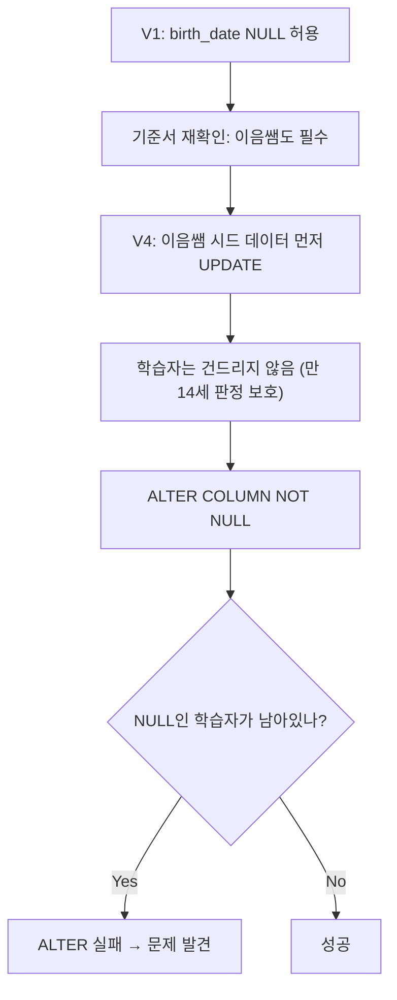

2026년 11월 2일부터 13일까지, 학습자와 담당 선생님("이음쌤")을 연결하는 안전 소통 학습 서비스 "이음"을 만든 팀 프로젝트 회고. 나는 DB 스키마와 문서를 맡았고, 그 과정에서 기준서와 어긋난 스키마를 두 번 고쳤다.

<!--more-->

## 안전과 소통을 함께 배우는 서비스, 이음 (Situation)

"이음"은 학습자가 안전·도움 요청·감정 읽기 같은 주제로 연습을 하고, 막히는 부분이 있으면 담당 "이음쌤"에게 쪽지로 질문할 수 있는 서비스다. 특히 학습자가 보낸 쪽지에 위험 신호로 분류되는 단어가 섞여 있으면 이음쌤에게 자동으로 알림이 가는 "신호 낱말" 기능이 핵심이었다. 나는 이 프로젝트에서 **DB 스키마 설계와 문서화**를 맡았고, 추가로 이음쌤용 API 하나를 구현했다. 백엔드 2명, 프론트엔드 1명과 함께 진행했고, 최종적으로 [ieum-lms.vercel.app](https://ieum-lms.vercel.app/) 으로 배포했다.

## 맡은 일 (Task)

학습자/이음쌤 계정, 연습 콘텐츠, 학습 기록, 쪽지, 신호 감지, 알림까지 8개 테이블의 초기 스키마(V1)를 설계하고, 이후 기능이 늘어날 때마다 마이그레이션(V2~V6)으로 스키마를 확장하면서 ERD와 DB 설계 문서를 계속 최신 상태로 유지하는 것이 핵심 작업이었다. 그 과정에서 실제 화면·API 기준서와 스키마가 어긋나는 지점들을 찾아서 바로잡아야 했다.

## 해결 과정 (Action)

### 8개 테이블로 시작한 초기 스키마

```sql
CREATE TABLE users (
  ...
  role    ENUM('STUDENT','TEACHER') NOT NULL DEFAULT 'STUDENT',
  birth_date DATE NULL,   -- 학습자는 필수, 이음쌤은 비워도 됨(당시 기준)
  teacher_id BIGINT UNSIGNED NULL,  -- 담당 이음쌤, 첫 쪽지 때 자동 배정
  ...
);
CREATE TABLE practices ( ... );         -- 연습 콘텐츠
CREATE TABLE practice_records ( ... );  -- 학습자 × 연습 기록
CREATE TABLE message_threads ( ... );   -- 쪽지 묶음
CREATE TABLE messages ( ... );          -- 쪽지 메시지
CREATE TABLE signal_keywords ( ... );   -- 신호 낱말 사전
CREATE TABLE signal_events ( ... );     -- 신호 감지 기록
CREATE TABLE notifications ( ... );     -- 앱 내 알림
```

계정(학습자/이음쌤 공통), 연습 콘텐츠, 학습 기록, 쪽지, 신호 감지, 알림까지 **8개 테이블을 하나의 V1 마이그레이션**으로 설계했다. `signal_keywords`에는 위험 신호로 분류할 단어 사전을, `signal_events`에는 실제로 감지된 메시지를 기록하는 테이블을 분리해서, "사전"과 "감지 이력"의 책임을 나눴다.

### 기준서와 어긋난 스키마를 두 번 고치다

```sql
-- V4: 이음쌤도 가입 때 생년월일을 필수로 받는다(화면·API 01 기준). users.birth_date를 NOT NULL로 바꾼다.
-- 이미 NULL로 들어간 이음쌤 계정(시드)은 임시 생년월일로 채운다. 학습자는 채우지 않는다:
--   임의 값을 넣으면 만 14세 미만 판정이 틀어지므로, NULL인 학습자가 있으면 아래 ALTER가 실패해 알려 준다.
UPDATE users SET birth_date = '1990-01-01' WHERE birth_date IS NULL AND role = 'TEACHER';
ALTER TABLE users MODIFY COLUMN birth_date DATE NOT NULL;
```

V1에서는 "이음쌤은 생년월일을 비워도 된다"고 설계했는데, 실제 **화면·API 기준서를 다시 보니 이음쌤도 가입 시 생년월일을 필수로 받아야** 했다. 스키마만 고치면 끝이 아니라서, **이미 들어가 있는 이음쌤 시드 데이터의 NULL부터 먼저 채운 다음** `NOT NULL` 제약조건을 걸었다 — 학습자 쪽은 임의 값을 넣으면 만 14세 미만 판정(보호자 동의 플로우)이 틀어지기 때문에 일부러 건드리지 않고, **혹시 NULL인 학습자가 남아있으면 ALTER가 그대로 실패하게 둬서 문제를 바로 알아차리도록** 했다.



이음쌤 이관(담당 교체) 기능이 추가될 때도 비슷한 패턴을 반복했다. `transfer_requests` 테이블(V6)을 추가하면서, `notifications`의 `type`·`link_type` ENUM에 이관 관련 값을 끼워 넣어야 했는데, **ENUM을 `ALTER ... MODIFY`로 바꿀 때 기존 값을 하나라도 빠뜨리면 기존 알림 데이터가 깨질 수 있다**는 걸 CodeRabbit 리뷰에서 지적받고서야 알았다 — 리뷰에 `SHOW COLUMNS FROM notifications`로 현재 정의를 먼저 확인하라는 체크포인트가 달려 있었다.

### 이음쌤 홈 API를 만들다가 서버가 안 뜬 날

DB 작업 외에, 이음쌤이 담당 학습자 목록과 요약 정보를 보는 API도 직접 구현했다. 그런데 배포 전 점검 과정에서 **서버 자체가 기동이 안 되는 문제**를 만났다.

```java
// 실제 구현 컨트롤러와 Mock 컨트롤러가 같은 주소를 매핑하고 있었다
@GetMapping("/teacher/summary")   // TeacherController (진짜 구현)
@GetMapping("/teacher/summary")   // TeacherMockController (초기 개발용 가짜 응답)
```

`/teacher/summary`, `/teacher/students`, `/teacher/students/{id}` 세 API를 실제 로직으로 구현하고 나니, **초반 프론트엔드 개발을 돕기 위해 만들어둔 Mock 컨트롤러가 같은 경로를 여전히 매핑하고 있어서** Spring이 어떤 컨트롤러로 요청을 보내야 할지 못 정하고 서버가 뜨지 않았다. Mock 컨트롤러에서 구현이 끝난 세 메소드만 지우고, 아직 구현 전인 나머지는 그대로 남겨두는 식으로 정리했다. 그리고 담당 학습자들의 기록·쪽지·신호를 조회할 때 **학습자 한 명씩 쿼리를 날리지 않도록 id 목록으로 한 번에 묶어 집계**해서 N+1 문제도 미리 피했다.

### README와 ERD를 실제 구현에 맞춰 계속 갱신하기

기능이 늘어날 때마다(V1 → V5 → V6) DB 설계 문서와 ERD 이미지, `README.md`도 같이 갱신했다. 프로젝트 막바지에는 "API 26개, 테이블 9개"로 README의 숫자를 실제 구현에 맞게 다시 맞추는 작업까지 했다 — 문서가 코드보다 뒤처지면 팀원들이 기준으로 삼을 게 없어진다는 걸 느꼈던 부분이다.

## 결과 (Result)

8개 테이블로 시작한 스키마가 기능이 늘면서 9개까지 늘었고, 그 과정에서 기준서와 어긋난 부분(이음쌤 생년월일 필수 여부)을 두 번 발견해서 바로잡았다. 특히 V4처럼 "일부 데이터만 선별적으로 채우고, 나머지는 실패하게 둬서 문제를 드러내는" 마이그레이션 작성법을 익혔고, CodeRabbit 리뷰 덕분에 ENUM 변경의 위험성도 배포 전에 걸러낼 수 있었다. Mock과 실제 컨트롤러의 URL 충돌로 서버가 안 뜨는 문제도 겪어봤는데, 기능을 하나씩 실제 구현으로 옮길 때마다 Mock 쪽 정리를 같이 해야 한다는 걸 몸으로 배웠다. 11월 13일, Vercel 배포까지 끝내며 2주짜리 프로젝트를 마무리했다.

## 더 학습하면 좋은 개념

- **DB 마이그레이션 도구(Flyway/Liquibase)의 버전 관리 규칙** — V1~V6까지는 번호를 손으로 관리했는데, 팀원이 늘어나면 ShooT 프로젝트 때처럼 번호가 겹칠 수 있다. 마이그레이션 도구가 이런 충돌을 어떻게 막아주는지 제대로 알아봐야 한다.
- **ENUM 대신 별도 코드 테이블(Lookup Table)** — `notifications.type`처럼 값이 계속 늘어나는 ENUM은 변경할 때마다 리스크가 있다는 걸 이번에 겪었다. 차라리 별도 테이블로 분리했으면 어땠을지 비교해보고 싶다.
- **계약(Interface) 기반 모듈 경계** — JPA 미니 프로젝트에서 배운 "Menu 팀이 인터페이스를 정의하고 Order 팀이 구현한다"는 패턴을, 이번 프로젝트의 Mock 컨트롤러 → 실제 컨트롤러 전환에도 적용했다면 URL 충돌 같은 문제를 더 깔끔하게 피할 수 있었을 것 같다.

## 참고 자료

- [Flyway 공식 문서 - Migrations](https://documentation.red-gate.com/fd/migrations-184127470.html)
- [MySQL 공식 문서 - ENUM Type](https://dev.mysql.com/doc/refman/8.0/en/enum.html)
- [CodeRabbit 공식 문서](https://docs.coderabbit.ai/)
