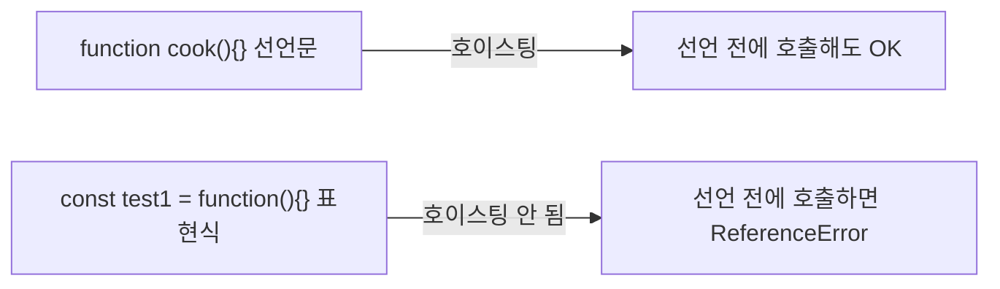

Spring 백엔드를 마치고 드디어 프론트엔드 쪽, 자바스크립트를 시작했다. "Java는 클래스 기반, JS는 함수 기반 객체지향"이라는 말이 뭔지, 변수부터 고차함수까지 자바와 하나하나 비교하며 배운 학습 노트다.

<!--more-->

## 클래스 기반 언어에서 함수 기반 언어로 (Situation)

자바로 변수·객체·함수·컬렉션을 배우고, JDBC·Spring까지 쭉 자바 생태계 안에서 달려왔는데, 오늘 처음 자바스크립트를 시작했다. 오늘의 미션도 "Java와 JavaScript의 동작 원리를 비교하고 서로에게 설명하기"였던 만큼, 거의 모든 개념을 자바와 1:1로 맞대보면서 배웠다.

## 배운 내용 (Task)

목표는 `var`/`let`/`const`와 동적 타입이 자바의 정적 타입과 어떻게 다른지, 객체 리터럴이 자바의 클래스 역할을 어떻게 대신하는지, 함수 선언문과 함수 표현식의 차이(특히 호이스팅), 화살표 함수 문법, 그리고 배열의 고차함수(forEach/map/filter)를 익히는 것이었다.

## 정리한 내용 (Action)

### 동적 타입 — 변수가 아니라 "값"이 타입을 가진다

```js
let test = 1;
test = "문자열";   // 자바라면 컴파일 에러, JS는 그냥 된다

console.log(typeof test1);  // undefined
test1 = 1;        console.log(typeof test1);  // number
test1 = "java";   console.log(typeof test1);  // string
test1 = null;     console.log(typeof test1);  // object (!)
test1 = [];       console.log(typeof test1);  // object
test1 = function(){}; console.log(typeof test1);  // function
```

자바는 `String str = "문자열"; str = 1;`이 컴파일조차 안 되는데, JS는 **변수 선언 시점이 아니라 값을 할당하는 시점에 타입이 정해진다.** 자유롭지만 "이 변수가 지금 무슨 타입인지" 코드만 보고는 확신할 수 없다는 단점도 같이 느껴졌다. 특히 `typeof null`이 `"object"`로 나오는 건 처음 보고 당황했다 — JS의 유명한 설계 함정 중 하나라고 한다.

### 객체 리터럴 — `{}`가 자바의 클래스 역할

```js
const store = {
    name: '원티드 식당',
    category: '분식',
    getInfo: function() {
        return `${this.name} 은 ${this.category} 전문점 입니다!`
    }
};
console.log(store.getInfo());
```

자바에서 `Store` 클래스를 만들고 필드·메소드를 정의하던 걸, JS에서는 **`{}` 중괄호 하나로 즉석에서 만들** 수 있었다. 게다가 `order.sauce = "뿌링클 시즈닝"`처럼 **클래스 정의 없이 객체에 프로퍼티를 동적으로 추가**할 수 있다는 게 자바와 가장 크게 다른 점이었다. 문자열 안에 변수를 바로 꽂아 쓰는 템플릿 리터럴(`` `${this.name}` ``)도 여기서 처음 썼다.

### 함수 선언문 vs 함수 표현식 — 호이스팅의 차이를 에러로 확인하다

```js
console.log(cook('떡볶이'))   // 정상 동작!

function cook(menuName) {    // 함수 선언문
    return `${menuName} 조리 시~작!`
}

console.log(test1("떡볶이"))  // ReferenceError!

const test1 = function (menuName) {  // 함수 표현식
    return `${menuName} 조리 시~작!`
}
```

**함수 선언문(`function cook(){}`)은 호출하는 코드보다 아래에 있어도 정상 동작**했다. JS 엔진이 실행 전에 함수 선언을 먼저 끌어올려(호이스팅) 인식해두기 때문이다. 반면 **함수 표현식(`const test1 = function(){}`)을 선언 전에 호출하면 에러**가 났다 — `const`로 선언한 변수는 선언문에 도달하기 전까지는 참조할 수 없다는 걸 직접 에러를 띄워보고 확인했다. 똑같이 함수를 만드는 것처럼 보여도 **선언 방식에 따라 호출 가능한 시점이 다르다**는 걸 이번에 제대로 체감했다.



### 화살표 함수 — Java 람다의 원조 격

```js
message = function() { return '주문 접수 OK!👌' }
message = () => { return '주문 접수 OK!👌' }
message = () => '주문 접수 OK!👌'              // 중괄호·return 생략
message = (menuName, menuPrice) => `${menuName} 의 가격 ${menuPrice}`
message = menuName => `${menuName} !!`         // 매개변수 1개면 괄호도 생략
```

`function` 키워드와 중괄호, `return`을 점점 줄여나가는 화살표 함수 문법을 익혔다. 재밌던 건 **"이 화살표 함수를 본떠서 자바에 람다 표현식이 생겼다"**는 설명이었다 — Spring Core에서 `@Aspect`나 `GrantedAuthority`를 람다로 만들던 게, 사실 JS 화살표 함수 쪽이 원조였다는 걸 알고 나니 두 언어가 묘하게 다시 연결되는 느낌이었다.

### 고차함수 — forEach/map/filter, 그리고 `==` vs `===`

```js
const menus = [
    { name: '치즈떡볶이', category: '분식', price: 14000 },
    { name: '순대', category: '분식', price: 3000 },
    { name: '파스타', category: '양식', price: 19000 },
];

menus.forEach(menu => console.log(menu));              // 순회만, 반환값 없음
const names = menus.map(menu => menu.name);             // 변환해서 새 배열
const snacks = menus.filter(menu => menu.category === '분식');  // 조건에 맞는 것만

// filter + filter + map 체이닝
const result = menus
    .filter(menu => menu.category === '분식')
    .filter(menu => menu.price < 10000)
    .map(menu => menu.name);
```

`forEach`/`map`/`filter`를 콜백 함수로 조합하는 방식이, 자바 JPA 미니 프로젝트에서 `menuList.stream().map(MenuDTO::from).toList()`처럼 짜던 Stream 체이닝과 완전히 똑같은 사고방식이었다. 다만 조건식을 쓸 때 `===`(일치 비교)와 `==`(동등 비교, 암묵적 타입 변환) 중 **`===`를 써야 한다**는 걸 `1 == '1'`이 `true`가 나오는 걸 직접 찍어보고 배웠다 — 자바에서 `==`이 객체 동일성, `.equals()`가 값 비교였던 것과는 또 다른 함정이었다.

## 결과 (Result)

변수와 타입부터 시작해서, 객체 리터럴이 자바의 클래스를, 화살표 함수가 람다를, 고차함수 체이닝이 Stream을 떠올리게 한다는 걸 계속 비교하며 배웠다. 가장 크게 남은 건 함수 선언문과 함수 표현식의 호이스팅 차이를 실제 에러로 겪은 것과, `==`/`===`의 함정이었다. "JS는 함수 기반 객체지향"이라는 말이 처음엔 추상적이었는데, 객체 리터럴에 함수를 메소드처럼 넣어보고 나니 조금씩 감이 잡혔다.

## 더 학습하면 좋은 개념

- **`this`의 동작 방식** — `store.getInfo()` 안에서 쓴 `this.name`이 일반 함수와 화살표 함수에서 다르게 동작한다고 들었는데, 오늘 예제는 전부 일반 함수라서 아직 그 차이를 겪어보지 못했다.
- **`var`와 `let`/`const`의 스코프 차이** — 오늘 `let`/`const`만 썼는데, `var`가 왜 최근엔 잘 안 쓰이는지(함수 스코프 vs 블록 스코프) 다음에 비교해봐야 한다.
- **reduce** — forEach/map/filter는 배웠는데 배열을 하나의 값으로 합치는 `reduce`는 오늘 다루지 않았다. 자바의 `Collectors`와 비교해보면 재밌을 것 같다.

## 참고 자료

- [MDN - typeof](https://developer.mozilla.org/ko/docs/Web/JavaScript/Reference/Operators/typeof)
- [MDN - Hoisting](https://developer.mozilla.org/ko/docs/Glossary/Hoisting)
- [MDN - Array.prototype.map()](https://developer.mozilla.org/ko/docs/Web/JavaScript/Reference/Global_Objects/Array/map)
