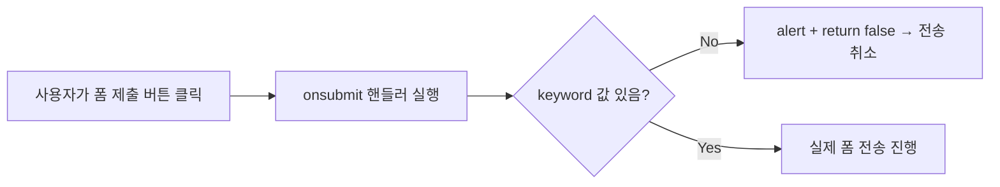

어제 변수·함수·고차함수를 배웠다면 오늘은 스프레드 문법과 구조 분해 할당, 그리고 브라우저 화면(DOM)을 직접 만지고 이벤트를 등록하는 법까지 배운 학습 노트다.

<!--more-->

## 코드만 보던 JS가 드디어 화면을 움직이다 (Situation)

어제까지는 콘솔 로그만 찍어보는 수준이었는데, 오늘은 스프레드 문법으로 배열/객체 복사를 정리하고, 드디어 **브라우저 화면의 요소를 직접 가져오고 바꾸는 DOM**, 그리고 버튼 클릭 같은 **이벤트**까지 다뤘다. 자바로 치면 콘솔 프로그램만 짜다가 처음 GUI를 건드려본 느낌이었다.

## 배운 내용 (Task)

목표는 스프레드 문법(`...`)으로 배열/객체를 복사할 때 원본 참조 공유와 실제 복사의 차이를 구분하고, 구조 분해 할당으로 배열·객체에서 값을 바로 꺼내는 법, `document`에서 요소를 찾는 4가지 방법, 그리고 이벤트 핸들러를 등록하는 3가지 방식과 이벤트 객체·`this`의 동작을 이해하는 것이었다.

## 정리한 내용 (Action)

### 스프레드 문법 — "복사"라는 말에 속으면 안 된다

```js
const cart = ['치킨', '피자'];
const cartRef = cart;        // 복사가 아니라 "같은 배열을 가리키는 변수"가 하나 더 생긴 것
const cartCopy = [...cart];  // 새로운 배열을 만들어서 값만 옮겨 담은 것 (얕은 복사)

cartRef.push('파스타');
console.log(cart, cartRef);  // 둘 다 ['치킨','피자','파스타'] -- 같은 배열이니까!

cartCopy.push('빠네파스타');
console.log(cart, cartCopy); // cart는 그대로, cartCopy만 바뀜
```

여기서 용어를 헷갈렸다 — `cartRef = cart`를 노트에 "깊은 복사"라고 적어뒀는데, 다시 보니 이건 **복사가 아니라 같은 배열을 가리키는 참조가 하나 더 생긴 것**뿐이었다. 반대로 `[...cart]`는 새 배열 컨테이너를 만들어서 값을 옮겨 담으니 **얕은 복사(shallow copy)**가 맞는 용어였다. (배열/객체 안에 또 배열이나 객체가 중첩되어 있으면, 스프레드로도 그 안쪽까지는 복사되지 않고 참조가 공유된다는 것까지가 "얕은"이라는 말의 의미라서, 다음에 꼭 정확히 정리해야겠다.)

```js
const order = { menuName: '뿌링클', qty: 2 };
const orderRef = order;
const orderCopy = { ...order };

console.log(order === orderRef);   // true  -- 같은 객체
console.log(order === orderCopy);  // false -- 값만 복사된 새 객체
```

**"여러 곳에서 같은 데이터를 참조로 공유하면, 한 곳에서 수정했을 때 다른 곳이 영문도 모른 채 바뀐다"**는 문제를 직접 `push()` 결과로 확인했다 — 지난 JPA 글에서 배운 "동일성 보장 문제"가 반대 방향(의도치 않게 같은 객체를 공유해서 생기는 문제)으로 다시 나타난 셈이었다.

### 구조 분해 할당 — 꺼내는 코드를 한 줄로

```js
const menuArr = ['치킨', '피자'];
const [chi1, piz1] = menuArr;   // 인덱스로 하나씩 꺼내던 걸 한 줄로

const menu = { name: '치즈알밥', price: 7500, category: '퓨전한식' };
const { name, price, category } = menu;  // 프로퍼티 key와 변수명이 일치해야 함

const { ...rest } = menu;  // 스프레드 + 구조분해 조합으로 객체 복사도 가능
```

`menuArr[0]`, `menuArr[1]`처럼 인덱스로 하나씩 꺼내던 코드가 `const [chi1, piz1] = menuArr`로 줄어들었다. 객체는 **프로퍼티 key와 받을 변수명이 같아야** 한다는 제약이 있어서, 이름이 다르면 또 다른 문법(별칭)이 필요하다는 것도 짚고 넘어갔다.

### DOM — document에서 요소를 찾는 4가지 방법

```js
document.getElementById('store');           // id로 1개 (중복되면 첫 번째만)
document.getElementsByTagName('li');        // 태그명으로 여러 개 (HTMLCollection)
document.getElementsByClassName('menu');    // class로 여러 개 (HTMLCollection)
document.querySelector('.box');             // CSS 선택자로 1개 (권장)
document.querySelectorAll('.box');          // CSS 선택자로 여러 개
```

id가 중복된 `<div id="store">`를 일부러 두 개 만들어보고 `getElementById`를 호출했더니 **첫 번째 요소만** 반환됐다 — id는 원래 문서 전체에서 유일해야 하는데, 중복되면 브라우저가 조용히 첫 번째만 골라준다는 걸 알게 됐다.

```js
const $snackLiList = document.getElementById('snack').getElementsByTagName('li');
// HTMLCollection 타입 -- forEach를 바로 못 쓴다!
const liList = Array.from($snackLiList);    // 배열로 변환
liList.forEach(li => li.style.color = 'red');
```

`getElementsByTagName`/`getElementsByClassName`의 반환 타입이 진짜 배열이 아니라 **HTMLCollection(유사 배열)**이라서, 어제 배운 `forEach`/`map`을 바로 쓸 수 없었다. `Array.from()`으로 변환해야 배열 전용 메소드를 쓸 수 있다는 게, "타입을 맞춰야 메소드를 쓸 수 있다"는 자바의 감각과 비슷하게 느껴졌다.

### 이벤트 핸들러 등록 — 3가지 방식, 그리고 제거

```js
// (1) 어트리뷰트 방식: <button onclick="recommend('김자바')">
// (2) 프로퍼티 방식: 1개만 등록 가능, 나중 게 이전 걸 덮어씀
$btnProp.onclick = function() { alert("1번째"); };
$btnProp.onclick = () => alert("2번째");  // 1번째는 사라진다!

// (3) addEventListener 방식 (권장): 여러 개 동시 등록 가능
$btnListener.addEventListener('click', function() { alert('결제 완료!'); });
$btnListener.addEventListener('click', function() { alert('2번째 addEvent 동작!'); });

// 이벤트 제거는 "같은 함수 참조"가 있어야 가능하다
const handleMouseOver = () => alert('호버!');
$btnRemove.addEventListener('mouseover', handleMouseOver);
$btnRemove.removeEventListener('mouseover', handleMouseOver);  // 익명 함수로는 제거 불가!
```

프로퍼티 방식(`onclick = ...`)은 **덮어쓰기**라서 핸들러가 1개만 유지되는데, `addEventListener`는 **같은 이벤트에 여러 핸들러를 동시에** 등록할 수 있었다. 대신 나중에 제거하려면 처음부터 **이름이 있는 함수를 참조로 등록**해둬야 한다는 것도 중요했다 — 익명 함수로 등록하면 나중에 `removeEventListener`에 같은 함수를 넘길 방법이 없기 때문이다.

### 이벤트 객체와 this

```js
function handleClick1() {
    console.log('click1', this);  // 일반 함수 내부의 this -> window (전역 객체)
}
function handleClick2(btn) {
    console.log('click2', btn);   // onclick="handleClick2(this)" 로 전달받은 this -> 클릭된 버튼 DOM
}

document.onclick = showCoords;
function showCoords(e) {
    $msg.textContent = `배달 위치 : ${e.clientX}, ${e.clientY}`;  // 이벤트 객체(e)로 좌표 꺼내기
}
```

어제 "`this`는 일반 함수와 화살표 함수에서 다르게 동작한다던데 아직 안 겪어봤다"고 적어뒀는데, 오늘 그 일부를 봤다 — **일반 함수 안의 `this`는 기본적으로 `window`**를 가리키고, DOM 요소에서 `onclick="...(this)"`처럼 명시적으로 넘겨야 그 요소 자체를 참조할 수 있었다. 다만 **화살표 함수에서 `this`가 어떻게 다른지는 오늘 예제(버튼 3·4)를 다 끝내지 못해서** 다음에 마저 확인해야 한다.

### 폼 이벤트 — focus/blur부터 submit 취소까지

```js
$username.onfocus = (e) => e.target.classList.toggle('lightgray');
$username.onblur = (e) => e.target.classList.toggle('lightgray');

// focus/blur는 버블링이 안 되므로, 폼 전체에 걸고 싶으면 focusin/focusout
$form.addEventListener('focusin', (e) => e.target.classList.add('focused'));

// input 이벤트로 글자 수 실시간 카운트
$request.addEventListener('input', (e) => {
    $form.querySelector('span').textContent = e.target.value.trim().length;
});

// submit 취소하기
$searchForm.onsubmit = function() {
    const keyword = this.querySelector('input[name=query]').value;
    if (!keyword) {
        alert('검색할 메뉴를 입력하지 않았습니다!');
        return false;  // 폼 전송 취소! (addEventListener라면 e.preventDefault())
    }
};
```



`focus`/`blur`는 해당 요소에서만 일어나고 버블링되지 않아서, 폼 전체에 걸고 싶으면 `focusin`/`focusout`을 써야 한다는 차이, 그리고 `onsubmit`에서 `return false`로 **서버에 보내기 전에 전송 자체를 막을 수 있다**는 걸 검색창 예제로 확인했다.

## 결과 (Result)

스프레드 문법에서 "참조 공유"와 "진짜 복사(얕은 복사)"를 혼동했던 내 노트를 다시 바로잡았고, 구조 분해 할당으로 값 꺼내는 코드가 훨씬 짧아지는 걸 체감했다. DOM에서는 `querySelector` 계열이 왜 권장되는지, HTMLCollection을 배열로 바꿔야 어제 배운 고차함수를 쓸 수 있다는 것도 확인했다. 이벤트는 등록 방식 3가지의 차이(특히 프로퍼티 방식의 덮어쓰기)와, `this`가 상황마다 다르게 동작한다는 걸 일부 확인했다 — 화살표 함수에서의 `this`는 다음 숙제로 남았다.

## 더 학습하면 좋은 개념

- **얕은 복사 vs 깊은 복사 정확히 정리하기** — 오늘 헷갈렸던 용어다. 스프레드는 1단계(최상위)만 복사하고 중첩된 객체/배열은 여전히 참조를 공유한다는 것까지 예제로 확인해야 한다.
- **화살표 함수에서의 `this`** — 오늘 버튼 3·4 예제를 완성하지 못했다. 일반 함수는 호출 방식에 따라 `this`가 바뀌지만, 화살표 함수는 자신을 감싼 스코프의 `this`를 그대로 쓴다고 들었는데 직접 코드로 확인해야 한다.
- **이벤트 버블링과 캡처링** — `focusin`/`focusout`이 버블링된다고 배웠는데, 버블링 자체의 전체 개념(이벤트가 부모로 전파되는 순서)은 오늘 깊이 다루지 않았다.

## 참고 자료

- [MDN - 구조 분해 할당](https://developer.mozilla.org/ko/docs/Web/JavaScript/Reference/Operators/Destructuring_assignment)
- [MDN - Document.querySelector()](https://developer.mozilla.org/ko/docs/Web/API/Document/querySelector)
- [MDN - EventTarget.addEventListener()](https://developer.mozilla.org/ko/docs/Web/API/EventTarget/addEventListener)
