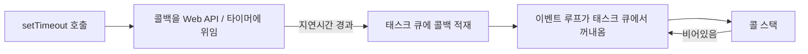

변수·함수·DOM·이벤트까지 다뤘으니 오늘은 자바스크립트의 꽃이라는 비동기 처리 차례다. `setTimeout`부터 콜백 지옥, 이를 해결하는 Promise와 async/await, 그리고 실제 API를 호출하는 `fetch`까지 하루 만에 쭉 훑은 학습 노트다.

<!--more-->

## 자바의 스레드 개념이 통하지 않는 동네 (Situation)

자바에서 오래 걸리는 작업은 스레드를 새로 띄우거나 `CompletableFuture`로 처리했는데, JS는 기본적으로 **싱글 스레드**라고 들었다. 그런데도 `setTimeout`으로 5초를 기다리는 코드를 쓰면서도 다음 줄이 안 막힌다는 게 이해가 안 갔다 — 오늘 그 비밀(이벤트 루프)을 풀었다.

## 배운 내용 (Task)

목표는 `setTimeout`/`setInterval`로 지연·반복 실행을 다뤄보고, 동기/비동기의 차이와 태스크 큐·이벤트 루프의 동작 원리를 이해한 다음, "콜백 지옥"이 왜 생기고 Promise와 async/await가 이를 각각 어떻게 해결하는지, 마지막으로 `fetch`로 외부 API를 호출해보는 것이었다.

## 정리한 내용 (Action)

### setTimeout / setInterval — 지연과 반복

```js
setTimeout(() => console.log('5초 경과! 피자 조리 완료~'), 5000);
console.log("주문하실 분!~~");   // 5초짜리 setTimeout보다 먼저 찍힌다

let count = 1;
const interval = setInterval(() => {
    console.log(`배달 도착까지 ${5 - count} 초`);
    count++;
    if (count == 5) {
        clearInterval(interval);  // 종료 조건 필수!
        console.log('배달 완료~~!');
    }
}, 1000);
```

`setTimeout(실행할 함수, 지연시간, ...인자)` 구조부터, "5초 뒤에 실행해줘"라고 예약만 해두고 **메인 코드 흐름은 그대로 아래로 진행**된다는 걸 직접 콘솔 순서로 확인했다. `setInterval`은 반복 실행이라 `clearInterval`로 끝낼 조건을 꼭 걸어줘야 한다는 것도 - 안 그러면 영원히 도는 타이머가 된다.

### 동기 vs 비동기, 그리고 이벤트 루프

```js
function sleep(func, delay) {
    const delayUntil = Date.now() + delay;
    while (Date.now() < delayUntil);  // 동기: 시간을 그냥 점유해버림
    func();
}

// 동기 처리의 한계 - takeOrder가 3초간 아예 멈춘다
// sleep(cook, 3000);
// takeOrder();

// 비동기 처리 - cook은 나중에, takeOrder는 바로바로
setTimeout(cook, 3000);
takeOrder();
takeOrder();
```

`sleep`처럼 while문으로 시간을 점유하는 건 "동기"고, `setTimeout`으로 콜백을 맡기고 바로 다음 코드로 넘어가는 게 "비동기"라는 걸 같은 상황 두 가지 버전으로 비교하며 체감했다. 그 뒤에 **태스크 큐**(콜백/이벤트 핸들러가 대기하는 곳)와 **이벤트 루프**(콜 스택이 비면 태스크 큐에서 하나씩 FIFO로 꺼내오는 감시자) 개념을 들었다 — 자바의 스레드 풀과는 전혀 다른, "하나의 실행 스레드 + 대기줄 + 감시 루프" 구조였다.



프론트 서버는 화면을, 백엔드는 데이터를 담당하다 보니 API 응답이 느리면 화면이 멈춰 보일 수 있어서 **JS 기반 프론트는 API 호출을 비동기로 처리하는 게 기본**이라는 이유도 납득이 됐다.

### 콜백 지옥 — "순서를 지키려다" 생기는 문제

```js
function point(point, func) {
    setTimeout(() => {
        const result = point + 10;
        if (func) func(result);
    }, 1000);
}

function runCallback() {
    point(0, point => {
        console.log(`${point}P`);          // 10P
        point(point, point => {
            console.log(`${point}P`);      // 20P
            point(point, point => {
                console.log(`${point}P`);  // 30P
                // ... 계속 중첩
            });
        });
    });
}
```

1초마다 10P씩 누적 적립하는 요구사항을 비동기 함수 호출 순서를 지키며 구현하려니, 콜백 안에 콜백을 계속 쌓게 됐다 - 이게 "콜백 지옥"이다. 코드가 오른쪽으로 계속 들여쓰기되면서 가독성이 급격히 떨어지는 걸 직접 겪어보니, 왜 Promise가 필요했는지 체감이 됐다.

### Promise — resolve/reject로 콜백 지옥 펴기

```js
function earnPoint(point) {
    return new Promise((resolve, reject) => {
        setTimeout(() => {
            const result = point + 10;
            if (result > 50) return reject(new Error("적립 한도 초과"));
            return resolve(result);
        }, 1000);
    });
}

earnPoint(0)
    .then(point => { console.log(`${point}P`); return earnPoint(point); })
    .then(point => { console.log(`${point}P`); return earnPoint(point); })
    .then(point => { console.log(`${point}P`); return earnPoint(point); })
    .catch(e => console.log(e, '발생~!!'))
    .finally(() => console.log("포인트 적립 종료"));
```

중첩이던 구조가 `.then()` 체이닝으로 한 줄씩 평평하게 펴졌다. 성공하면 `resolve`에 담긴 값을 다음 `.then()`이 받고, 한도 초과처럼 실패하면 `reject`로 보내서 `.catch()`가 한 곳에서 잡아낸다는 게, 어제 배운 Stream 체이닝(`filter().map()`)이랑 또 닮아 보였다 - 다만 여기선 각 단계가 "1초 기다린 후"라는 시간차가 끼어있다는 점이 다르다.

### async/await — 비동기를 동기처럼 읽히게

```js
async function runAsync() {
    try {
        let point = await earnPoint(0);
        console.log(`${point}P`);
        point = await earnPoint(point);
        console.log(`${point}P`);
        // ...
    } catch (e) {
        console.log(e, '발생!!!');
    }
}
```

`.then()` 체이닝이 사라지고 **위에서 아래로 읽히는 동기 코드처럼** 작성할 수 있었다 - `await`가 Promise의 `resolve` 값을 꺼내주는 역할을 한다. 대신 메소드 체이닝이 아니라서 `.catch()` 대신 **try-catch로 감싸야** 예외를 잡을 수 있다는 차이도 짚었다. Promise, async/await 둘 다 "비동기 처리 결과를 언제 쓸 수 있을지 모른다"는 문제를 해결하는 문법이라는 게 핵심이었다.

### fetch — 진짜 비동기 통신

```js
async function getReviews() {
    // 외부 API 호출 (fetch 는 Promise 를 반환한다)
    const data = fetch('https://jsonplaceholder.typicode.com/posts?_limit=5');

    // 2. async - await
    const res = await data;           // Response 객체
    const reviews = await res.json(); // 문자열 JSON -> JS 객체

    console.log(reviews);
    console.log(reviews[0].title);
}
```

`fetch()`가 반환하는 것도 결국 Promise라서, `await`로 응답 객체를 받고 `res.json()`(이것도 Promise!)을 한 번 더 `await`해야 실제 JS 객체가 나온다는 흐름을 정리했다. 처음 예제 코드엔 `fetch` 결과를 변수에 담지 않고 바로 `console.log`를 찍거나, `async` 없는 함수에 `await`를 쓰는 실수가 있었는데, "fetch도 Promise를 반환한다"는 점과 "`await`는 `async` 함수 안에서만 쓸 수 있다"는 제약을 되짚어서 바로 고쳤다.

## 결과 (Result)

`setTimeout` 하나로 시작해서 이벤트 루프 구조를 이해하고, 콜백 지옥을 직접 겪은 뒤 Promise와 async/await가 각각 어떤 방식으로 그 문제를 풀어내는지 비교할 수 있었다. 특히 "비동기인데 동기처럼 읽히게 만든다"는 async/await의 본질이 가장 크게 와닿았고, `fetch`도 결국 Promise 기반이라는 걸 알고 나니 오늘 배운 문법이 전부 한 줄로 꿰어졌다.

## 더 학습하면 좋은 개념

- **Promise.all / Promise.race** - 여러 개의 비동기 작업을 동시에 실행하고 결과를 한 번에 받는 방법은 오늘 다루지 않았다.
- **axios와 fetch의 차이** - 수업에서 `fetch`/`ajax`/`axios`가 언급만 되고 넘어갔는데, 실제 프로젝트에서 왜 axios를 더 선호하는지 비교해봐야겠다.

## 참고 자료

- [MDN - setTimeout()](https://developer.mozilla.org/ko/docs/Web/API/setTimeout)
- [MDN - Using Promises](https://developer.mozilla.org/ko/docs/Web/JavaScript/Guide/Using_promises)
- [MDN - async function](https://developer.mozilla.org/ko/docs/Web/JavaScript/Reference/Statements/async_function)
- [MDN - Fetch API](https://developer.mozilla.org/ko/docs/Web/API/Fetch_API)
