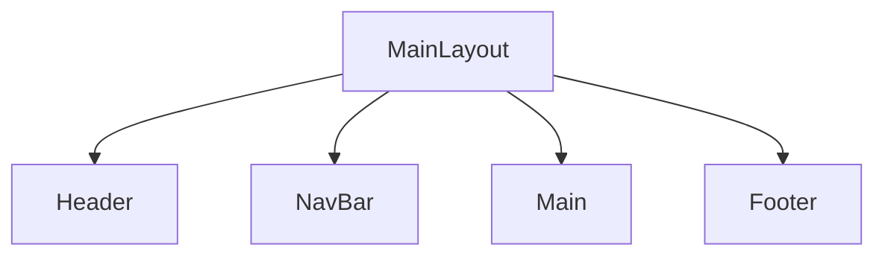

바닐라 JS로 DOM을 직접 만지던 걸 지나, 드디어 리액트를 시작했다. `createElement`로 가상 DOM이 뭔지 맛본 다음, JSX와 함수형 컴포넌트, 그리고 작은 컴포넌트를 모아 화면을 조립하는 법까지 배운 첫날 학습 노트다.

<!--more-->

## 바닐라 JS 다음은 리액트였다 (Situation)

지난주까지 `getElementById`, `addEventListener`로 DOM을 하나하나 찾아서 조작했는데, 오늘부터는 리액트로 넘어갔다. 리액트는 CDN 스크립트 두 줄(`react`, `react-dom`)만 추가하면 바로 쓸 수 있었고, 여기에 JSX를 쓰려면 바벨 스크립트가 하나 더 필요했다. "라이브러리 import"로 시작할 수 있다는 게 생각보다 가벼워서, 거창한 프레임워크라고만 생각했던 이미지가 조금 깨졌다.

## 배운 내용 (Task)

목표는 `React.createElement`로 요소를 직접 만들어보며 가상 DOM 개념을 이해하고, 함수형 컴포넌트가 "엘리먼트를 반환하는 함수"라는 걸 확인한 다음, JSX 문법과 그 작성 규칙(최상위 요소 하나, Fragment)을 익히고, 마지막으로 여러 개의 작은 컴포넌트를 조합해서 하나의 레이아웃으로 합치는 것이었다.

## 정리한 내용 (Action)

### createElement와 가상 DOM

```js
// 1번째 인자: 만들려는 요소의 타입 (h1, div, pre...)
// 2번째 인자: 요소의 프로퍼티
// 3번째 인자: 자식 요소
const hiElement = React.createElement('h1', { className: 'hi' }, 'helloworld!!');

ReactDOM.createRoot(document.getElementById('root')).render(hiElement);
```

리액트는 실제 DOM을 바로 건드리는 게 아니라, 메모리 상에 코드로 구현된 **가상 DOM(Virtual DOM)** 을 먼저 만든다는 개념을 처음 들었다. `createElement`가 그 가상 DOM 조각 하나를 만드는 함수였고, `render()`가 그걸 실제 `#root`에 그려주는 역할이었다.

### 함수형 컴포넌트 — 엘리먼트를 반환하는 함수

```js
// 함수 이름 앞글자는 대문자! (암묵적 규칙)
function Helloworld() {
    return React.createElement('h1', { className: 'hi' }, 'helloworld!!');
}

ReactDOM.createRoot(document.getElementById('root'))
    .render(React.createElement(Helloworld));
```

컴포넌트는 **엘리먼트를 반환하는, 화면의 구성 조각 단위**라고 정의됐다. 자바로 치면 그냥 함수 하나일 뿐인데, "엘리먼트를 반환한다"는 역할이 있어서 일반 함수와 구분하려고 **앞글자를 대문자**로 쓰는 걸 관례로 쓴다는 게 인상적이었다 — 실제로 뒤에 나온 JSX 예제에서 `<Header/>`처럼 앞글자가 소문자면 리액트가 컴포넌트가 아니라 그냥 html 태그로 인식해버린다.

### JSX — 바벨이 번역해주는 XML 같은 문법

```js
function formatName(user) {
    return `${user.lastName} ${user.firstName}`;
}

const user = { firstName: '평훈', lastName: '조' };

// 중괄호 안에 모든 js 표현식을 쓸 수 있다
const element = <h1 class="test">안녕!! {formatName(user)}</h1>;

ReactDOM.createRoot(document.getElementById('root')).render(element);
```

`createElement`를 계속 손으로 쓰면 너무 번거로워서 나온 게 **JSX**였다. `<script type="text/babel">`로 바꾸고 바벨 스크립트만 추가하면, html처럼 생긴 문법을 그대로 쓸 수 있고 중괄호 `{}`로 js 표현식을 끼워 넣을 수 있었다. 다만 위 예제의 `class="test"`는 그대로 따라 치긴 했지만, 리액트 JSX에서는 `class`가 아니라 `className`을 써야 한다고 알고 있어서 — 오늘 예제 코드 자체에 남아있던 오타(혹은 구버전 표기)인 것 같다. 다음에 직접 `class`로 렌더링해보고 실제로 경고가 뜨는지 확인해봐야겠다.

### JSX 규칙 — 최상위 요소는 하나, 그리고 Fragment

```js
// 1. 최상위 엘리먼트가 두 개 이상이면 문법 에러
// const element = (
//     <h1>{user.name}</h1>
//     <h3>{user.phone}</h3>
// );

// 2. div로 감싸면 되지만, 불필요한 div가 하나 생긴다
// const element = (
//     <div>
//         <h1>{user.name}</h1>
//         <h3>{user.phone}</h3>
//     </div>
// );

// 3. <></> (React.Fragment) 로 감싸면 눈에 보이지 않는 최상위 요소가 된다
const element = (
    <>
        <h1>{user.name}</h1>
        <h3>{user.phone}</h3>
    </>
);
```

동일 레벨 요소를 나란히 두면 문법 에러가 난다는 걸 직접 겪어봤다 — JSX 하나가 결국 **하나의 돔 트리**를 표현해야 하기 때문이었다. `div`로 감싸면 해결은 되지만 레이아웃에 불필요한 `div`가 남는데, `<></>` (Fragment) 를 쓰면 화면에는 안 보이면서 문법만 만족시킬 수 있다는 게 꽤 실용적으로 느껴졌다.

### 컴포넌트 조합(Composition) — 작은 컴포넌트를 모아 레이아웃 만들기

```js
function Header() {
    return (<><h1>헤더입니다!!</h1><h3>사이트 이름~~~</h3></>);
}
function NavBar() {
    return (<><h3>네비게이션 바 입니다!</h3></>);
}
function Footer() {
    return (<><h3>푸터 입니다!!</h3></>);
}

const user = { name: "조평훈", phone: "010-5518-2290", age: 20, gender: '남' };

function Main() {
    return (
        <>
            <h3>이름 : {user.name} </h3>
            <h3>전화번호 : {user.phone} </h3>
            <h3>나이 : {user.age} </h3>
            <h3>성별 : {user.gender} </h3>
        </>
    );
}

function MainLayout() {
    return (
        <div style={{ border: '1px solid black', backgroundColor: 'red' }}>
            <Header/>
            <NavBar/>
            <Main/>
            <Footer/>
        </div>
    );
}

ReactDOM.createRoot(document.getElementById('root')).render(<MainLayout/>);
```



오늘 가장 재밌었던 부분이다. `Header`, `NavBar`, `Main`, `Footer`를 각각 작은 함수형 컴포넌트로 따로 만들어두고, `MainLayout`이라는 컴포넌트 안에서 `<Header/>`처럼 태그로 가져다 쓰기만 하면 하나의 화면이 완성됐다. html 인라인 스타일을 줄 때 `style={{...}}`처럼 **중괄호를 두 번** 써야 하는 것도 처음엔 헷갈렸는데, 바깥 중괄호는 "JS 표현식이다"라는 뜻이고 안쪽 중괄호는 그 표현식이 **객체 리터럴**이라는 의미였다 — 둘을 따로 생각하니 이해가 됐다.

## 결과 (Result)

`createElement`로 가상 DOM 개념을 직접 눈으로 본 다음, JSX가 왜 그걸 대신해주는 문법인지 체감했다. JSX는 "html처럼 생긴 js"일 뿐이라서 중괄호로 어떤 표현식이든 끼워 넣을 수 있다는 것, 그리고 최상위 요소는 반드시 하나여야 해서 Fragment가 필요하다는 규칙까지 확인했다. 가장 크게 느낀 건 컴포넌트 조합이었다 — 작은 조각(Header/NavBar/Main/Footer)을 만들어두고 레이아웃 컴포넌트에서 태그처럼 조립하는 방식이, 어제까지 하던 `querySelector`로 매번 DOM을 찾아 바꾸던 방식과는 완전히 다른 사고방식이라는 걸 알았다.

## 더 학습하면 좋은 개념

- **`class` vs `className`** — 오늘 예제 코드에 `class="test"`가 그대로 남아있었는데, 리액트 JSX의 정석은 `className`이다. 실제로 `class`를 쓰면 어떤 경고/동작 차이가 나는지 직접 확인해야 한다.
- **props로 데이터 전달하기** — 오늘은 `Main` 컴포넌트 안에서 바깥의 `user` 변수를 그냥 참조했는데, 컴포넌트끼리 데이터를 주고받는 정식 방법(props)은 아직 안 배웠다.
- **state와 이벤트 연결** — 어제 배운 이벤트 핸들러를 리액트 컴포넌트 안에서는 어떻게 등록하고, 상태가 바뀔 때 화면이 어떻게 다시 그려지는지는 다음 내용일 것 같다.

## 참고 자료

- [React 공식 문서 - Quick Start](https://react.dev/learn)
- [React 공식 문서 - JSX로 마크업 작성하기](https://react.dev/learn/writing-markup-with-jsx)
- [Babel - JSX 트랜스파일](https://babeljs.io/docs/babel-plugin-transform-react-jsx)
