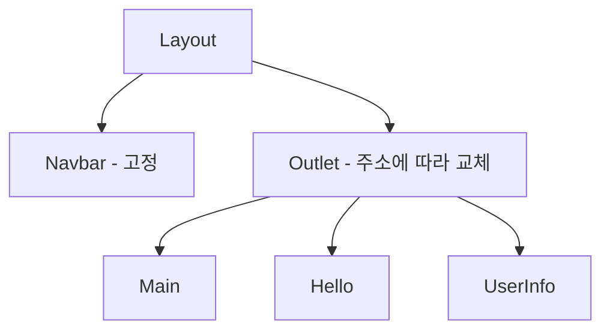

어제는 `createElement`부터 컴포넌트 조합까지 겨우 손에 익혔는데, 오늘은 그 조각난 컴포넌트들을 실제 페이지처럼 하나로 엮어서 보여주는 법을 배웠다. 카드 하나짜리 컴포넌트를 여러 개 붙여서 화면을 만들고, 주소가 바뀌어도 새로고침 없이 다른 화면을 보여주는 걸 직접 만들어보니 React가 왜 SPA라고 불리는지 감이 왔다.

<!--more-->

## 조각난 컴포넌트를 실제 화면으로 (Situation)

Vite로 프로젝트를 새로 만들고, 어제 만든 것 같은 작은 컴포넌트 여러 개를 `App` 하나에 그냥 나열하는 걸로는 한계가 있다는 걸 느꼈다. 현실의 프로젝트는 페이지가 여러 개고, 페이지마다 보여야 할 컴포넌트가 다른데, 오늘은 그걸 어떻게 해결하는지가 궁금했다.

## 배운 내용 (Task)

props로 받은 데이터를 여러 개의 작은 컴포넌트로 쪼개서 조립하는 법, `react-router-dom`으로 페이지 라우팅을 구성하는 법(`Layout` + `Outlet`, `Navbar` + `NavLink`), CSS Module로 스타일 충돌을 피하는 법을 배웠다. 그리고 심화로 SSR/CSR 렌더링 차이, React가 SPA로 동작하는 원리, React와 Next.js의 렌더링 차이까지 정리했다.

## 정리한 내용 (Action)

### 카드형 컴포넌트 조립하기

하나의 `user` 객체를 여러 하위 컴포넌트가 나눠서 보여주도록 구성했다.

```js
export const user = {
    name : '조평훈',
    age : 20,
    email : "raccoon@email.com"
};
```

```js
import { user } from "./user";

export default function NameCard() {
    return <h1 style={{color:'red'}}>{user.name}</h1>
}
```

이렇게 만든 `NameCard`, `AgeCard`, `EmailCard`를 `UserInfo`라는 상위 컴포넌트에서 한 번에 묶었다.

```js
import NameCard from "./NameCard";
import AgeCard from "./AgeCard";
import EmailCard from "./EmailCard";

function UserInfo() {
    return (
        <div style={ {width : 300, border : '1px solid black'} }>
            <NameCard/>
            <AgeCard/>
            <EmailCard/>
        </div>
    );
}
```

`export default`는 이름 없이 파일당 1개만 내보낼 수 있고, `export`는 `{}`로 받아서 여러 개를 하나의 파일에서 내보낼 수 있다는 차이도 같이 정리했다.

### react-router-dom으로 라우팅 구성하기

라우팅은 요청한 URL 주소에 따라 보여줄 컴포넌트를 정의하는 것이다. `BrowserRouter`가 라우팅 영역 전체를 감싸고, `Routes` 안에 `Route`로 경로와 컴포넌트를 짝지어준다.

```js
<BrowserRouter>
  <Routes>
    <Route path="/" element={<Layout/>}>
      <Route index element = {<Main/>}/>
      <Route path="vite/intro" element = {<Hello/>}/>
      <Route path="vite/module" element = {<UserInfo/>}/>
    </Route>
  </Routes>
</BrowserRouter>
```

`Layout`은 공통 레이아웃(네비게이션 바)을 고정해두고, 그 안의 `Outlet` 자리에 현재 주소와 일치하는 컴포넌트만 바꿔 끼워준다.

```js
function Layout() {
    return (
        <div className={styles.layout}>
            <Navbar/>
            <main className={styles.content}>
                <Outlet/>
            </main>
        </div>
    );
}
```



메뉴 클릭은 `<a>`가 아니라 `NavLink`로 처리한다. `<a href>`는 페이지 전체를 다시 불러오지만, `NavLink`(`Link`에 활성 상태 표시가 더해진 것)는 새로고침 없이 주소만 바꿔서 `Outlet` 부분만 교체한다. 이게 오늘 몸으로 확인한 SPA의 핵심이었다.

### CSS Module로 스타일 충돌 피하기

`Navbar.module.css`처럼 `.module.css`로 작성하고 객체로 import해서 `className`에 넣으면, 클래스명이 `Navbar-module__nav__xxxxx`처럼 고유하게 바뀌어 다른 컴포넌트와 이름이 겹쳐도 충돌하지 않는다. 그냥 `import './style.css'`로 가져오면 페이지 전체에 적용되는 것과 대비된다.

### SSR / CSR 렌더링 차이

- Thymeleaf는 서버에서 HTML을 완성해서 내려주는 **SSR(서버 사이드 렌더링)** 방식이다. 요청이 올 때마다 서버가 템플릿과 데이터를 조합해 완성된 HTML을 응답한다.
- React는 처음에 빈 HTML(`#root`)과 JS 번들만 내려주고, 브라우저에서 JS가 실행되면서 화면을 그리는 **CSR(클라이언트 사이드 렌더링)** 방식이다. `main.jsx`의 `createRoot(...).render(<App/>)`가 바로 그 시작점이다.

### React의 SPA 동작 원리

React가 Single Page Application인 이유는, 페이지 전체를 다시 요청하지 않고 하나의 HTML 위에서 JS가 DOM을 갈아 끼우기 때문이다. 오늘 만든 `BrowserRouter` + `Routes` + `Outlet` 구조가 그 메커니즘 자체였다. 주소가 바뀌면 브라우저는 서버에 새로 요청을 보내지 않고, React Router가 현재 주소에 맞는 컴포넌트를 찾아 `Outlet` 자리만 교체한다. 그래서 `Navbar`처럼 공통 영역은 그대로 유지되고, 콘텐츠만 바뀌는 게 눈에 보였다.

### (심화) React vs Next.js 렌더링 차이

- React(Vite 등)는 기본적으로 CSR이다. 빈 HTML을 던져주고 브라우저가 렌더링을 끝낸다. 초기 로딩이 느리고 검색엔진 최적화(SEO)에 불리할 수 있다.
- Next.js는 기본적으로 SSR(또는 빌드 시점 렌더링인 SSG)이다. 서버에서 완성된 HTML을 미리 그려서 내려주고, 이후 React가 그 위에 이벤트를 붙이는 하이드레이션(hydration) 과정을 거친다. 같은 React 컴포넌트 문법을 쓰면서도 "누가 먼저 그리느냐"가 다르다는 게 오늘 가장 크게 와닿은 차이였다.

## 결과 (Result)

컴포넌트를 쪼개는 이유와, 그걸 라우팅으로 이어붙이는 이유가 연결되는 하루였다. props로 쪼갠 작은 컴포넌트들이 결국 `Outlet`을 통해 페이지 단위로 조립되고, 그 조립 방식의 차이(어디서 HTML을 완성하느냐)가 SSR/CSR을 가르고, Next.js가 왜 따로 필요한지도 설명해준다는 걸 알았다.

## 더 학습하면 좋은 개념

- **Hydration** — Next.js에서 서버가 그린 HTML에 React가 이벤트를 붙이는 과정, 오늘은 개념만 짚고 코드로는 안 다뤘다.
- **useState / 상태관리** — `Outlet`으로 바뀌는 화면 안에서 데이터가 바뀔 때 다시 그리는 법.
- **동적 라우트 파라미터** — `:id` 같은 패턴과 `useParams`, 오늘은 고정된 경로만 써봤다.
- **React Server Component** — Next.js가 SSR을 한 단계 더 끌고 간 개념.

## 참고 자료

- [React Router 공식 문서](https://reactrouter.com/)
- [React 공식 문서 - Rendering](https://react.dev/learn/render-and-commit)
- [Next.js 공식 문서 - Rendering](https://nextjs.org/docs/app/building-your-application/rendering)
